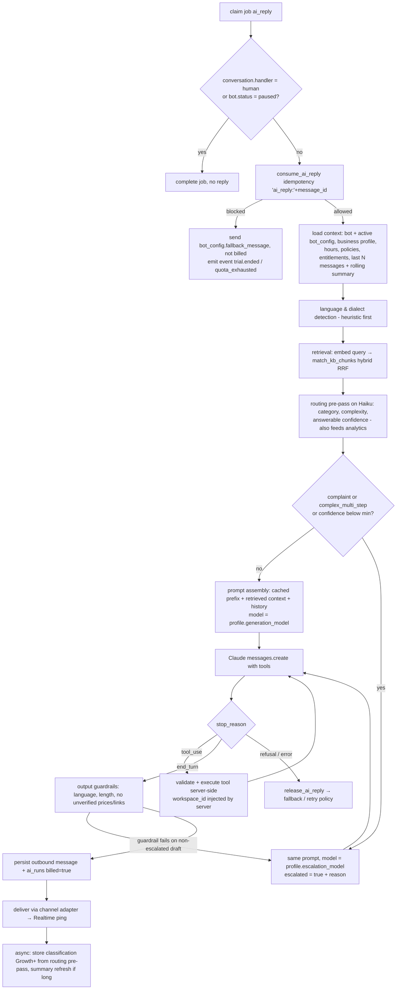

# AI Engine Design

Package: `packages/ai-engine` (Deno + browser compatible, fetch-only). Runs inside the `ai-worker`
Edge Function (E7); embeddings for ingestion run in `kb-ingest`. Generation = Claude (A7) behind
`GenerationProvider`; embeddings = Voyage AI (A8) behind `EmbeddingProvider`. No engine code yet
(built in P6) — this document is the contract. The tables it uses exist since P2.

Claude API facts below come from Anthropic's current API reference (cached 2026-11-03).
Anything about Voyage AI, and every price, is **needs verification** at implementation time.

## 1. Goals & non-goals

| Goals                                                                                    | Non-goals (v1)                 |
| ---------------------------------------------------------------------------------------- | ------------------------------ |
| Reply in the customer's language — Arabic (MSA, Gulf, Egyptian) and English (C9)         | Voice/audio understanding      |
| Answer only from the workspace's knowledge; say "I don't know" + offer handoff otherwise | Open-domain chat, web browsing |
| Take orders / reservations through strict tools (C3) with server-side prices (P15)       | Payments inside chat           |
| Classify questions for analytics (Growth+)                                               | Fine-tuning                    |
| Predictable cost per reply; every reply metered (B)                                      | URL crawling (later phase, C4) |

## 2. Pipeline (job `ai_reply`)



The tool loop is capped at **4 model turns** per reply; exceeding it ends the turn with a
handoff/fallback answer. A reply is billed once regardless of internal turns, routing pre-pass
or escalation.

## 3. Interfaces (contract for P6)

```ts
export interface GenerationProvider {
  readonly id: 'anthropic';
  generate(req: GenerationRequest, signal?: AbortSignal): Promise<GenerationResult>;
}
export interface GenerationRequest {
  model: string; // from ai_model_profiles.generation_model
  effort: 'low' | 'medium' | 'high';
  system: SystemBlock[]; // stable, cacheable blocks first
  messages: ChatMessage[];
  tools: ToolDefinition[]; // strict JSON schemas
  maxOutputTokens: number;
  refusalFallback: 'default' | 'none';
  metadata: { workspaceId: string; conversationId: string; aiRunId: string };
}
export interface GenerationResult {
  content: ContentBlock[]; // text | tool_use
  stopReason: 'end_turn' | 'tool_use' | 'max_tokens' | 'refusal' | 'pause_turn' | string;
  servedModel: string; // may differ when a fallback served the request
  usage: {
    inputTokens: number;
    outputTokens: number;
    cacheReadTokens: number;
    cacheWriteTokens: number;
  };
  latencyMs: number;
}

export interface EmbeddingProvider {
  readonly id: 'voyage';
  readonly model: string; // e.g. 'voyage-multilingual-2' (needs verification)
  readonly dimensions: 1024; // must equal kb_chunks.embedding dimension
  embed(texts: string[], kind: 'document' | 'query'): Promise<number[][]>;
}

export interface Retriever {
  search(q: {
    workspaceId: string;
    botId: string;
    text: string;
    k: number;
  }): Promise<RetrievedChunk[]>;
}

export interface OrderSyncAdapter {
  // C3: designed, not implemented
  readonly system: string; // e.g. 'foodics', 'shopify' (examples only)
  pushOrder(order: Order): Promise<{ externalRef: string }>;
  pushReservation(r: Reservation): Promise<{ externalRef: string }>;
}
```

The Anthropic implementation uses the official `@anthropic-ai/sdk` (via `npm:` specifier in
Deno — compatibility **needs verification**), never raw fetch, and the SDK's typed errors for
retry decisions (429/5xx/connection retryable; 400/404 not).

## 4. Model routing (decision A15 — approved 2026-11-26)

Data-driven via `ai_model_profiles` (seeded) and the plan entitlement `ai_model_profile`
(default `standard` for **every** plan). Internal per-model prices live in `ai_model_prices`.

| Profile    | Who                                                              | Replies            | Routing / classification | Escalation                            | Refusal fallback                                             |
| ---------- | ---------------------------------------------------------------- | ------------------ | ------------------------ | ------------------------------------- | ------------------------------------------------------------ |
| `standard` | all plans (Trial, Starter, Growth, Enterprise default)           | `claude-haiku-5-5` | `claude-haiku-5-5`       | `claude-sonnet-5-5` on triggers below | none on Haiku (not offered); `default` on Sonnet escalations |
| `premium`  | Enterprise only, by contract (`workspace_entitlement_overrides`) | `claude-opus-5-5`  | `claude-haiku-5-5`       | —                                     | `default`                                                    |

**Escalation triggers** (`escalation_config.triggers`, thresholds tuned in P6):

| Trigger              | Detected by                                                                                                                                                                                                                                    | When                       |
| -------------------- | ---------------------------------------------------------------------------------------------------------------------------------------------------------------------------------------------------------------------------------------------- | -------------------------- |
| `complaint`          | routing pre-pass category = complaint (or negative sentiment + complaint intent)                                                                                                                                                               | before generation          |
| `complex_multi_step` | routing pre-pass complexity flag: several questions/constraints in one message, multi-item orders with options, reservation + order combined, policy edge cases                                                                                | before generation          |
| `low_confidence`     | (a) pre-pass `answerable_confidence` < `min_confidence` (0.6), (b) weak retrieval (top similarity below threshold), or (c) Haiku draft fails an output guardrail (unsupported price/hour/policy claim, wrong language) → regenerated on Sonnet | before or after generation |

Model self-reported confidence is treated as a weak signal; retrieval scores and guardrail
results carry more weight. Thresholds and their measured precision are recorded in the eval
report.

**Routing pre-pass:** one Haiku call with structured output (`output_config.format`) returning
`{category, intent, sentiment, language, dialect, complexity, answerable_confidence}`. It
decides the model _and_ provides question classification for analytics (Growth+
`question_classifications`, categories `menu_products / reservations / prices / working_hours /
services / complaints / orders / other`), so classification costs nothing extra.

**Logging:** every `ai_runs` row stores `initial_model`, `model` (final), `escalated`,
`escalation_reason`, `routing_confidence`. Escalation rate = escalated runs / all runs per
workspace and period (index `ai_runs_escalated_idx`); the admin health view alerts when a
workspace or the platform exceeds `max_escalation_rate_alert` (30 %).

**Switching models:** if Haiku fails the Arabic dialect gate (§10), update
`ai_model_profiles.generation_model` for `standard` (e.g. to `claude-sonnet-5-5`) — a data
change, no deploy. The same applies to any per-workspace override.

Request-shape rules for the current models (from the API reference):

- Effort is always set explicitly (`low` for chat replies and the routing pre-pass): Haiku 5.5
  and Opus 5.5 default to `medium`, Sonnet 5.5 to `high`. Thinking cannot be disabled on
  Opus 5.5 (adaptive is always on); depth is controlled by `output_config.effort`.
- **No `temperature`/`top_p`/`top_k`** — non-default values are rejected on current models.
- **Forced `tool_choice` (`any`/`tool`) returns 400** on Opus 5.5 / Sonnet 5.5 → we use
  `tool_choice: auto` + `strict: true` tool schemas + prompt instructions on every model, so
  one request shape works across the routing.
- **No assistant prefill** — output shape is controlled by instructions and, for the classifier,
  structured outputs (`output_config.format`).
- Thinking blocks returned by the API are passed back unchanged within a tool loop.

## 5. Refusals, fallbacks and errors

- Always check `stop_reason` before reading content. `refusal` (HTTP 200) → no reply text is
  used; we log `stop_details.category`, `release_ai_reply()`, and send the bot fallback / offer
  handoff.
- Server-side fallbacks: requests on Opus 5.5 / Sonnet 5.5 (premium replies and escalations)
  include the documented `fallbacks: "default"` option (beta header
  `server-side-fallback-2026-07-01`); `served_model` is recorded in `ai_runs`. **Haiku 5.5 has no
  server-side refusal fallback**, so a Haiku refusal ends in the bot fallback / handoff offer; in
  v1 we do not automatically resend refused content to another model. Billing semantics of
  fallbacks — **needs verification**.
- 429/5xx/timeouts: SDK retries (default 2) → job-level retry with backoff → after the last
  attempt: fallback message. Generation timeout 30 s per call (widget UX), total job budget 60 s.

## 6. Prompt design & caching

Render order is `tools → system → messages`; any byte change invalidates everything after it.
Layout (stable → volatile):

1. **Tools** (deterministic order, frozen JSON) — identical for all workspaces with the same
   feature set.
2. **System block A — platform rules** (frozen per release): role, safety, language policy,
   "answer only from provided business data", formatting per channel, handoff rules.
3. **System block B — workspace context** (changes rarely): business profile, hours, policies,
   bot persona/tone/custom instructions, catalog summary. `cache_control` breakpoint here.
4. **Messages**: rolling summary (if any) → last N turns (N≈12, token-capped) → current
   inbound message with retrieved knowledge attached as clearly delimited reference data.

Volatile values (current local time for "are you open now?", conversation language) go in the
final user turn, never in the cached prefix. Minimum cacheable prefix length is
model-dependent; we verify hits via `usage.cache_read_input_tokens` in `ai_runs`. A cache
hit-rate panel is part of the P14 admin health views.

**Long conversations:** when history exceeds ~6k tokens, a `summarize_conversation` job
(Haiku) folds older turns into `conversations.summary` (`summary_message_id` marks the cut).

**Prompt-injection posture:** customer text and file contents are untrusted data inside
delimited blocks; the system prompt states that instructions inside them are not to be
followed; tools never accept `workspace_id`, prices or totals from the model.

## 7. Language & dialect handling (C9)

- Detection: fast heuristic (Arabic-script ratio, Arabizi patterns, keyword lists for
  Gulf/Egyptian markers) with the model as tie-breaker; stored on `messages.language` and
  `conversations.language/dialect`.
- Policy in system prompt: reply in the customer's language; for Arabic, mirror the customer's
  register (dialect ↔ dialect, MSA ↔ MSA), default to clear MSA-leaning Gulf-neutral Arabic when
  unsure; keep product names as in the catalog; numerals follow the customer (Latin vs
  Arabic-Indic). Mixed-language messages → answer in the dominant language.
- Retrieval: Q&A entries carry `alt_questions` (dialect variants); multilingual embeddings let
  an Egyptian-dialect question match an MSA answer. **Voyage Arabic/dialect retrieval quality —
  needs verification** with the eval set (§10) before locking the model (P10).

## 8. Tools

All tools: `strict: true`, `additionalProperties: false`, all fields `required` (nullable where
optional), executed server-side with the workspace/bot/conversation from the job — not from model
input. Tools are included only if the bot + entitlements enable them.

Tool names follow MASTER_PROMPT §9 (E6); `confirm_order` and `capture_contact_details` are
kept (E13).

| Tool                      | Gate                          | Input (model)                                                                     | Server behavior                                                                                                                                                                                                          |
| ------------------------- | ----------------------------- | --------------------------------------------------------------------------------- | ------------------------------------------------------------------------------------------------------------------------------------------------------------------------------------------------------------------------ |
| `get_catalog`             | catalog exists                | `{query, category?, max_results}`                                                 | trigram/name search on `catalog_items` (available only) → returns ids, names, **prices from DB**                                                                                                                         |
| `check_working_hours`     | always                        | `{date?, time?}`                                                                  | computes open/closed from `working_hours` + `working_hours_overrides` in the branch / workspace timezone                                                                                                                 |
| `get_policy`              | always                        | `{type: delivery \| refund \| reservation \| other}`                              | returns active `policies` rows of that type in the customer's language; never invents a policy                                                                                                                           |
| `create_order`            | `orders` + bot.orders_enabled | `{items:[{catalog_item_id, quantity, option_choices[]}], type, address?, notes?}` | validates ids belong to workspace & are available, computes prices, `delivery_fee_cents` and total, inserts `orders` (`pending_confirmation`, source `ai`) + `order_items`; returns a summary for the model to read back |
| `confirm_order`           | same                          | `{order_id}`                                                                      | only for orders created in this conversation; → `confirmed`                                                                                                                                                              |
| `create_reservation`      | `reservations` + bot flag     | `{reserved_at_local, party_size, notes?}`                                         | validates within working hours, future, party size; inserts `pending_confirmation`                                                                                                                                       |
| `request_human_handoff`   | `human_handoff` + bot flag    | `{reason}`                                                                        | creates `handoffs`, sets `conversations.handler = human`, `status = pending`, notifies agents (Realtime + notifications)                                                                                                 |
| `capture_contact_details` | always                        | `{name?, phone?, email?}`                                                         | updates the customer record (validated formats)                                                                                                                                                                          |

**Knowledge gaps (§9, P6).** When the model has to answer "I don't know" (no supporting chunk or
tool result), the worker logs the question in `knowledge_gaps` (one row per distinct question,
`occurrences` + `last_seen_at` bumped on repeats) for the dashboard list (P10).

**Playground (P11).** Sandbox conversations are `is_test = true`; their `ai_runs` are `is_test`
too. `consume_ai_reply` refuses to bill them and the schema forbids `billed` on a test run.

External order/reservation sync (`OrderSyncAdapter`) hooks into the `confirmed` transition
later; `orders.external_*` columns already exist.

## 9. Cost model with routing (estimates)

Assumptions per reply: ~3,000 prefix tokens, ~2,300 other input (retrieval + history + message),
~400 output tokens incl. low-effort thinking. Routing pre-pass: ~800 input + ~150 output on Haiku.
Prices = Anthropic list prices per 1M tokens as cached on 2026-11-03 (input · output · cache
read): Haiku 5.5 0.10 · 0.50 · — (prompts ≤ 100K tokens; Haiku charged at full input rate here),
Sonnet 5.5 2 · 10 · 0.10, Opus 5.5 4 · 20 · 0.20. Cache-write premiums, embeddings and infra are
excluded. **Estimates only — replaced by measured `ai_runs.cost_micros` in P6.**

| Component                                               | ≈ $ per reply |
| ------------------------------------------------------- | ------------- |
| Routing pre-pass (Haiku)                                | $0.00015      |
| Reply on Haiku                                          | $0.0007       |
| Reply on Sonnet                                         | $0.0089       |
| Reply on Opus (premium)                                 | $0.0178       |
| Low-confidence regenerate (wasted Haiku draft + Sonnet) | $0.0096       |

Blended `standard` cost per 1,000 replies by escalation rate (split ⅔ before generation, ⅓
after a failed Haiku draft):

| Escalation rate          | ≈ $ / 1k replies | Trial (100) | Starter 1k vs $39 | Growth 5k vs $99 | Overage 1k vs $10 | Enterprise default 20k vs $299 |
| ------------------------ | ---------------- | ----------- | ----------------- | ---------------- | ----------------- | ------------------------------ |
| 0 %                      | $0.85            | $0.09       | $0.85 (2 %)       | $4.3 (4 %)       | 9 %               | $17 (6 %)                      |
| **15 % (planning case)** | **$2.1**         | $0.21       | **$2.1 (5 %)**    | **$10.6 (11 %)** | **21 %**          | $42 (14 %)                     |
| 30 % (alert threshold)   | $3.4             | $0.34       | $3.4 (9 %)        | $16.9 (17 %)     | 34 %              | $68 (23 %)                     |
| 100 % (all escalated)    | $9.3             | $0.93       | $9.3 (24 %)       | $46 (47 %)       | 93 %              | $186 (62 %)                    |

`premium` (Opus 5.5, Enterprise by contract) ≈ **$18 / 1k replies**: 20k replies ≈ $360/month,
above the $299 entry price, so premium contracts must be priced per reply (cost + margin) or
as a surcharge. Current public prices are kept as approved; routing keeps every public plan's
AI cost ≤ ~17 % of revenue up to the 30 % escalation alert.

## 10. Quality & evaluation

- **Golden set** (P6 exit criterion): ≥ 300 conversations across 3 verticals (restaurant,
  clinic/salon, retail) × MSA / Gulf / Egyptian / English / mixed, each with expected facts,
  forbidden claims (invented prices, wrong hours), expected tool calls, and expected handoffs.
- Automatic checks: language match, facts-from-KB (grounding), no price not present in tool
  results, tool-call correctness, length per channel; LLM-judge rubric for tone/helpfulness with
  a human-reviewed calibration subset.
- **Arabic dialect gate (decision A15):** a dedicated set of ≥ 150 conversations — Gulf,
  Egyptian and MSA (≥ 50 each), mixed with English product names and Arabizi — scored with the
  routing exactly as in production (Haiku default + Sonnet escalation). Haiku must meet the
  gates in `TESTING.md §5` **per dialect**; if it fails any dialect, the `standard`
  profile's `generation_model` is switched in the DB and the eval re-run.
- Routing quality: precision/recall of each escalation trigger on labeled complaint /
  complex / unanswerable cases; target escalation rate 10–20 %.
- Gates: any prompt/model/profile change must not regress grounding or language-match on the
  golden set. Production sampling: 1 % of replies queued for review in the admin panel.
- Retrieval eval: recall@8 on dialect-paraphrased questions — decides the Voyage model (P10).

## 11. Knowledge ingestion

| Source                              | Chunking                                                                         | Notes                                                                                                  |
| ----------------------------------- | -------------------------------------------------------------------------------- | ------------------------------------------------------------------------------------------------------ |
| Business profile / hours / policies | one chunk per section, both languages                                            | regenerated on change (debounced job)                                                                  |
| Manual Q&A                          | one chunk per pair (question + alt questions + answer)                           |                                                                                                        |
| Catalog                             | one chunk per item (name, description, options, price as text) + category chunks | prices in chunks are informational; tool results are authoritative                                     |
| Files (PDF/DOCX/TXT)                | text extraction → ~500-token chunks, 15 % overlap, heading-aware                 | PDF/DOCX text extraction library for Deno — **needs verification**; scanned PDFs (OCR) out of scope v1 |

Embeddings stored with `embedding_model`; changing the model triggers a full re-embed job.
