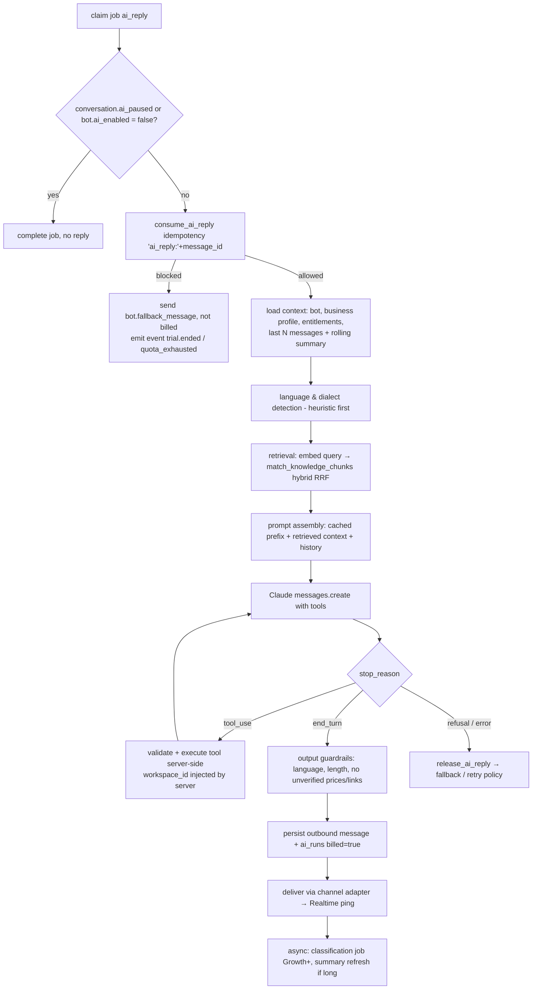

# AI Engine Design

Package: `packages/ai-engine` (Deno + browser compatible, fetch-only). Runs inside the `worker`
Edge Function. Generation = Claude (A7) behind `GenerationProvider`; embeddings = Voyage AI (A8)
behind `EmbeddingProvider`. No code in Phase 01 — this document is the contract.

Claude API facts below come from Anthropic's current API reference (cached 2026-11-03).
Anything about Voyage AI, and every price, is **needs verification** at implementation time.

## 1. Goals & non-goals

| Goals                                                                                    | Non-goals (v1)                 |
| ---------------------------------------------------------------------------------------- | ------------------------------ |
| Reply in the customer's language — Arabic (MSA, Gulf, Egyptian) and English (C9)         | Voice/audio understanding      |
| Answer only from the workspace's knowledge; say "I don't know" + offer handoff otherwise | Open-domain chat, web browsing |
| Take orders / reservations through strict tools (C3) with server-side prices (P15)       | Payments inside chat           |
| Classify questions for analytics (Growth+)                                               | Fine-tuning                    |
| Predictable cost per reply; every reply metered (B)                                      | URL crawling (later phase, C4) |

## 2. Pipeline (job `ai_reply`)



The tool loop is capped at **4 model turns** per reply; exceeding it ends the turn with a
handoff/fallback answer. A reply is billed once regardless of internal turns.

## 3. Interfaces (contract for Phase 04)

```ts
export interface GenerationProvider {
  readonly id: 'anthropic';
  generate(req: GenerationRequest, signal?: AbortSignal): Promise<GenerationResult>;
}
export interface GenerationRequest {
  model: string; // from ai_model_profiles.generation_model
  effort: 'low' | 'medium' | 'high';
  system: SystemBlock[]; // stable, cacheable blocks first
  messages: ChatMessage[];
  tools: ToolDefinition[]; // strict JSON schemas
  maxOutputTokens: number;
  refusalFallback: 'default' | 'none';
  metadata: { workspaceId: string; conversationId: string; aiRunId: string };
}
export interface GenerationResult {
  content: ContentBlock[]; // text | tool_use
  stopReason: 'end_turn' | 'tool_use' | 'max_tokens' | 'refusal' | 'pause_turn' | string;
  servedModel: string; // may differ when a fallback served the request
  usage: {
    inputTokens: number;
    outputTokens: number;
    cacheReadTokens: number;
    cacheWriteTokens: number;
  };
  latencyMs: number;
}

export interface EmbeddingProvider {
  readonly id: 'voyage';
  readonly model: string; // e.g. 'voyage-multilingual-2' (needs verification)
  readonly dimensions: 1024; // must equal knowledge_chunks.embedding dimension
  embed(texts: string[], kind: 'document' | 'query'): Promise<number[][]>;
}

export interface Retriever {
  search(q: {
    workspaceId: string;
    botId: string;
    text: string;
    k: number;
  }): Promise<RetrievedChunk[]>;
}

export interface OrderSyncAdapter {
  // C3: designed, not implemented
  readonly system: string; // e.g. 'foodics', 'shopify' (examples only)
  pushOrder(order: Order): Promise<{ externalRef: string }>;
  pushReservation(r: Reservation): Promise<{ externalRef: string }>;
}
```

The Anthropic implementation uses the official `@anthropic-ai/sdk` (via `npm:` specifier in
Deno — compatibility **needs verification**), never raw fetch, and the SDK's typed errors for
retry decisions (429/5xx/connection retryable; 400/404 not).

## 4. Model selection (P9 — owner decision)

Data-driven via `ai_model_profiles` (seeded) and the plan entitlement `ai_model_profile`.

| Profile              | Generation model    | Classifier         | Effort |
| -------------------- | ------------------- | ------------------ | ------ |
| `standard` (default) | `claude-opus-5-5`   | `claude-haiku-5-5` | `low`  |
| `balanced`           | `claude-sonnet-5-5` | `claude-haiku-5-5` | `low`  |
| `economy`            | `claude-haiku-5-5`  | `claude-haiku-5-5` | `low`  |

Request-shape rules for the current models (from the API reference):

- **Thinking cannot be disabled** on Opus 5.5 (adaptive thinking is always on); depth is
  controlled only by `output_config.effort`. Opus 5.5's default effort is `medium`, so we set
  `low` explicitly for chat replies. (Sonnet 5.5's default is `high`; set explicitly too.)
- **No `temperature`/`top_p`/`top_k`** — non-default values are rejected on current models.
- **Forced `tool_choice` (`any`/`tool`) returns 400** on Opus 5.5 / Sonnet 5.5 → we use
  `tool_choice: auto` + `strict: true` tool schemas + prompt instructions.
- **No assistant prefill** — output shape is controlled by instructions and, for the classifier,
  structured outputs (`output_config.format`).
- Thinking blocks returned by the API are passed back unchanged within a tool loop.

## 5. Refusals, fallbacks and errors

- Always check `stop_reason` before reading content. `refusal` (HTTP 200) → no reply text is
  used; we log `stop_details.category`, `release_ai_reply()`, and send the bot fallback / offer
  handoff.
- Server-side fallbacks: requests on Opus 5.5 / Sonnet 5.5 include the documented
  `fallbacks: "default"` option (beta header `server-side-fallback-2026-07-01`) so a refusal can
  be retried on a fallback model server-side; `served_model` is recorded in `ai_runs`. This is
  controlled per profile by `refusal_fallback`. Billing semantics of fallbacks — **needs verification**.
- 429/5xx/timeouts: SDK retries (default 2) → job-level retry with backoff → after the last
  attempt: fallback message. Generation timeout 30 s per call (widget UX), total job budget 60 s.

## 6. Prompt design & caching

Render order is `tools → system → messages`; any byte change invalidates everything after it.
Layout (stable → volatile):

1. **Tools** (deterministic order, frozen JSON) — identical for all workspaces with the same
   feature set.
2. **System block A — platform rules** (frozen per release): role, safety, language policy,
   "answer only from provided business data", formatting per channel, handoff rules.
3. **System block B — workspace context** (changes rarely): business profile, hours, policies,
   bot persona/tone/custom instructions, catalog summary. `cache_control` breakpoint here.
4. **Messages**: rolling summary (if any) → last N turns (N≈12, token-capped) → current
   inbound message with retrieved knowledge attached as clearly delimited reference data.

Volatile values (current local time for "are you open now?", conversation language) go in the
final user turn, never in the cached prefix. Minimum cacheable prefix length is
model-dependent; we verify hits via `usage.cache_read_input_tokens` in `ai_runs`. A cache
hit-rate panel is part of Phase 07 admin health.

**Long conversations:** when history exceeds ~6k tokens, a `summarize_conversation` job
(Haiku) folds older turns into `conversations.summary` (`summary_message_id` marks the cut).

**Prompt-injection posture:** customer text and file contents are untrusted data inside
delimited blocks; the system prompt states that instructions inside them are not to be
followed; tools never accept `workspace_id`, prices or totals from the model.

## 7. Language & dialect handling (C9)

- Detection: fast heuristic (Arabic-script ratio, Arabizi patterns, keyword lists for
  Gulf/Egyptian markers) with the model as tie-breaker; stored on `messages.language` and
  `conversations.language/dialect`.
- Policy in system prompt: reply in the customer's language; for Arabic, mirror the customer's
  register (dialect ↔ dialect, MSA ↔ MSA), default to clear MSA-leaning Gulf-neutral Arabic when
  unsure; keep product names as in the catalog; numerals follow the customer (Latin vs
  Arabic-Indic). Mixed-language messages → answer in the dominant language.
- Retrieval: Q&A entries carry `alt_questions` (dialect variants); multilingual embeddings let
  an Egyptian-dialect question match an MSA answer. **Voyage Arabic/dialect retrieval quality —
  needs verification** with the eval set (§10) before locking the model (P10).

## 8. Tools

All tools: `strict: true`, `additionalProperties: false`, all fields `required` (nullable where
optional), executed server-side with the workspace/bot/conversation from the job — not from model
input. Tools are included only if the bot + entitlements enable them.

| Tool                      | Gate                          | Input (model)                                                                                          | Server behavior                                                                                                                                                                                                              |
| ------------------------- | ----------------------------- | ------------------------------------------------------------------------------------------------------ | ---------------------------------------------------------------------------------------------------------------------------------------------------------------------------------------------------------------------------- |
| `search_catalog`          | catalog exists                | `{query, category?, max_results}`                                                                      | trigram/name search on `catalog_items` (available only) → returns ids, names, **prices from DB**                                                                                                                             |
| `get_business_hours`      | always                        | `{date?}`                                                                                              | computes open/closed from `opening_hours` + `special_hours` in branch TZ                                                                                                                                                     |
| `create_order`            | `orders` + bot.orders_enabled | `{items:[{catalog_item_id, quantity, option_choices[]}], fulfillment_type, delivery_address?, notes?}` | validates ids belong to workspace & are available, computes prices/total, inserts `orders` (`pending_confirmation`, source `ai`) + `order_items`; returns summary for the model to read back and ask the customer to confirm |
| `confirm_order`           | same                          | `{order_id}`                                                                                           | only for orders created in this conversation; → `confirmed`                                                                                                                                                                  |
| `create_reservation`      | `reservations` + bot flag     | `{starts_at_local, party_size, notes?}`                                                                | validates within opening hours, future, party size; inserts `pending_confirmation`                                                                                                                                           |
| `request_handoff`         | `human_handoff` + bot flag    | `{reason}`                                                                                             | creates `handoffs`, sets `conversations.ai_paused = true`, status `pending_handoff`, notifies agents (Realtime)                                                                                                              |
| `capture_contact_details` | always                        | `{name?, phone?, email?}`                                                                              | updates contact (validated formats)                                                                                                                                                                                          |

External order/reservation sync (`OrderSyncAdapter`) hooks into the `confirmed` transition
later; `orders.external_*` columns already exist.

## 9. Cost model (estimates — for the P9 decision)

Assumptions per reply: ~3,000 cached prefix tokens, ~2,300 uncached input (retrieval + history +
message), ~400 output tokens incl. low-effort thinking. Prices = Anthropic list prices per 1M
tokens (input / output / cache read) as cached on 2026-11-03; cache-write premiums and
embeddings excluded. **Estimates only — to be replaced by measured `ai_runs` costs in Phase 04.**

| Model               | $/M in · out · cache-read | ≈ $/reply | ≈ $/1,000 replies | Starter (1k) cost vs $39 | Growth (5k) cost vs $99 | Overage cost vs $10/1k |
| ------------------- | ------------------------- | --------- | ----------------- | ------------------------ | ----------------------- | ---------------------- |
| `claude-opus-5-5`   | 4 · 20 · 0.20             | ~$0.018   | ~$18              | ~46 % of revenue         | **~90 %** of revenue    | **below cost**         |
| `claude-sonnet-5-5` | 2 · 10 · 0.10             | ~$0.009   | ~$9               | ~23 %                    | ~45 %                   | ~90 %                  |
| `claude-haiku-5-5`  | 0.10 · 0.50 · —           | ~$0.0007  | ~$0.7             | ~2 %                     | ~4 %                    | ~7 %                   |

**Decision needed (owner):** with Opus 5.5 as the default, Growth and overage pricing is not
sustainable at full utilization. Options: (a) keep Opus 5.5 at `low` effort and re-price
Growth/overage; (b) choose a different profile per plan (e.g. Growth on `balanced`); (c) route
by difficulty. Quality must be measured on the Arabic eval set (§10) before deciding; the
schema already supports any of these without code changes.

## 10. Quality & evaluation

- **Golden set** (Phase 04 exit criterion): ≥ 300 conversations across 3 verticals (restaurant,
  clinic/salon, retail) × MSA / Gulf / Egyptian / English / mixed, each with expected facts,
  forbidden claims (invented prices, wrong hours), expected tool calls, and expected handoffs.
- Automatic checks: language match, facts-from-KB (grounding), no price not present in tool
  results, tool-call correctness, length per channel; LLM-judge rubric for tone/helpfulness with
  a human-reviewed calibration subset.
- Gates: any prompt/model/profile change must not regress grounding or language-match on the
  golden set. Production sampling: 1 % of replies queued for review in the admin panel.
- Retrieval eval: recall@8 on dialect-paraphrased questions — decides the Voyage model (P10).

## 11. Knowledge ingestion

| Source                              | Chunking                                                                         | Notes                                                                                                  |
| ----------------------------------- | -------------------------------------------------------------------------------- | ------------------------------------------------------------------------------------------------------ |
| Business profile / hours / policies | one chunk per section, both languages                                            | regenerated on change (debounced job)                                                                  |
| Manual Q&A                          | one chunk per pair (question + alt questions + answer)                           |                                                                                                        |
| Catalog                             | one chunk per item (name, description, options, price as text) + category chunks | prices in chunks are informational; tool results are authoritative                                     |
| Files (PDF/DOCX/TXT)                | text extraction → ~500-token chunks, 15 % overlap, heading-aware                 | PDF/DOCX text extraction library for Deno — **needs verification**; scanned PDFs (OCR) out of scope v1 |

Embeddings stored with `embedding_model`; changing the model triggers a full re-embed job.
