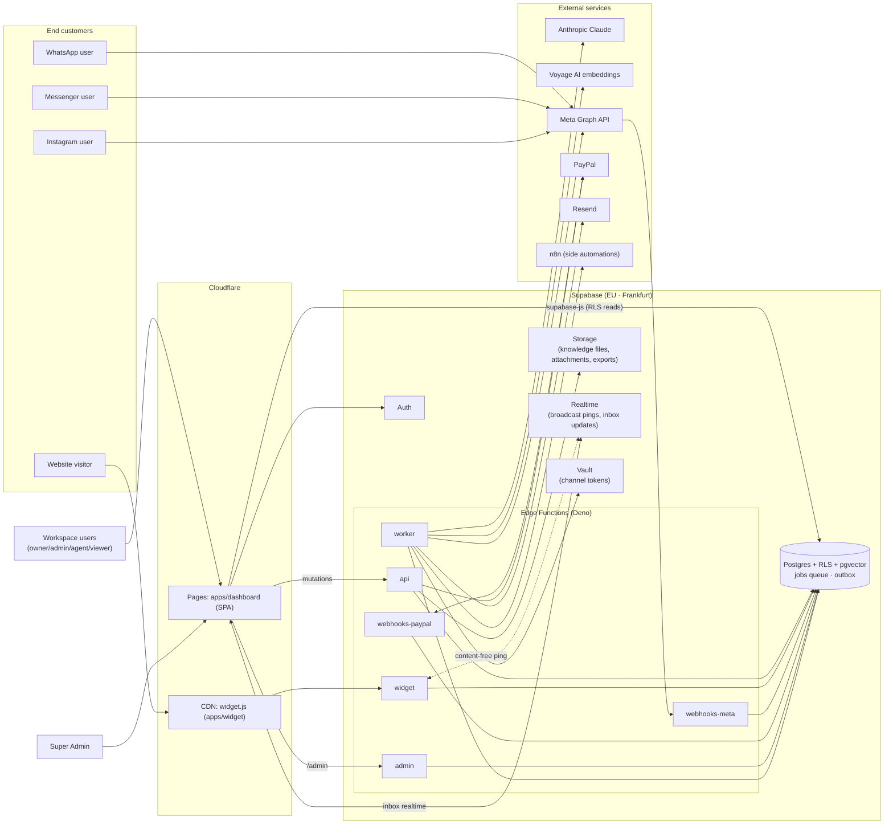

# Architecture

> Status: **Phase 01 design — awaiting owner approval.** Decisions referenced as `A*`, `B`, `C*`
> (approved) and `P*` (proposed) are defined in [`DECISIONS.md`](./DECISIONS.md).
> Items marked **needs verification** depend on third-party behavior not yet confirmed
> against current vendor documentation.

## 1. System overview



**Core principle:** the customer-message path is `channel → edge function → Postgres (message +
job) → worker → Claude → Postgres → channel`. n8n and email are _never_ in that path (A11);
they consume the outbox asynchronously.

## 2. Monorepo layout (A1)

```
apps/
  dashboard/        React + Vite + TS + Tailwind v4 + shadcn/ui (customer app + /admin)
  widget/           Embeddable chat widget (Preact in Shadow DOM — P8), built to one IIFE
packages/
  shared/           Runtime-agnostic constants/types (brand, locales, DB types, zod schemas)
  ai-engine/        Provider-agnostic AI pipeline (Deno-compatible, fetch-only)
supabase/
  migrations/       SQL migrations (timestamped)
  functions/        Edge Functions (Deno) + _shared/
  tests/database/   pgTAP suites (RLS, limits, metering)
docs/               Product + engineering docs (this folder)
```

`packages/*` must run in **both** the browser (Vite) and Deno (edge functions): no Node
built-ins, explicit `.ts` import extensions, `fetch` only. How edge functions consume workspace
packages (import map vs. vendored bundle) — **needs verification** with the current Supabase CLI
bundler (RISK R-14).

## 3. Multi-tenancy model (C1, C2)

- **Tenant = `workspace`.** Every tenant-owned row carries `workspace_id`.
- Hierarchy: `workspace → branches (optional, Enterprise) → bots`. An organization layer can be
  added later as `organizations` + nullable `workspaces.organization_id` without touching
  tenant-scoped tables.
- **Composite foreign keys** `(workspace_id, id)` on core relations (bots, channel connections,
  contacts, conversations, messages, orders…) make cross-tenant references impossible even for
  service-role code paths.
- **RLS is the security boundary** for every client read. Policies call `SECURITY DEFINER`
  helpers in the non-exposed `private` schema:
  `is_workspace_member`, `has_workspace_role`, `can_write` (role + workspace writable),
  `is_platform_admin`.
- **Column-level grants** restrict what clients can update (e.g. `workspaces.status` and
  `channel_connections.*` are never client-writable — "real statuses only", A14).
- **Workspace roles** (C2): Owner / Admin / Agent / Viewer. **Super Admin** lives in
  `platform_admins`, separate from workspace roles; admin operations run through the `admin`
  function with the service role and are always written to `audit_logs`.

| Capability                                                         | Owner |     Admin     | Agent | Viewer |
| ------------------------------------------------------------------ | :---: | :-----------: | :---: | :----: |
| View inbox, contacts, analytics                                    |   ✓   |       ✓       |   ✓   |   ✓    |
| Reply / assign / close conversations, edit contacts, update orders |   ✓   |       ✓       |   ✓   |        |
| Bots, knowledge, catalog, widget appearance, branches              |   ✓   |       ✓       |       |        |
| Channel connection requests                                        |   ✓   |       ✓       |       |        |
| Members & invitations                                              |   ✓   | ✓ (not owner) |       |        |
| Billing, plan changes, payment history                             |   ✓   |     view      |       |        |
| Data export / workspace deletion, API keys                         |   ✓   |   API keys    |       |        |

## 4. Edge Functions

| Function          | Auth                                                                                 | Responsibilities                                                                                                                                                                                                                                                                                                                                                 |
| ----------------- | ------------------------------------------------------------------------------------ | ---------------------------------------------------------------------------------------------------------------------------------------------------------------------------------------------------------------------------------------------------------------------------------------------------------------------------------------------------------------- |
| `api`             | Supabase JWT (dashboard) · API key (Enterprise)                                      | Workspace creation (workspace + owner + trial atomically), invitations, member/role changes, channel connection requests, widget key rotation & allowed origins, signed upload URLs + ingestion jobs, agent replies (insert + deliver), handoff actions, checkout/subscription changes, manual payment requests, data export/delete, Enterprise `/v1` public API |
| `widget`          | Widget `public_key` + Origin allow-list + visitor token                              | Bootstrap config, start/resume conversation, send message, fetch messages since cursor                                                                                                                                                                                                                                                                           |
| `worker`          | `WORKER_SECRET` header (called by itself, other functions and the cron sweep)        | Claims jobs (`claim_jobs`), runs AI replies, ingestion/embedding, delivery, usage rollover, trial expiry, retention purge, exports, outbox dispatch (Resend + n8n)                                                                                                                                                                                               |
| `webhooks-meta`   | Meta verify token (GET) + `X-Hub-Signature-256` HMAC (POST) — **needs verification** | Normalizes WhatsApp/Messenger/Instagram events, upserts contact/conversation/message idempotently, enqueues `ai_reply`, records delivery statuses                                                                                                                                                                                                                |
| `webhooks-paypal` | PayPal webhook signature verification — **needs verification**                       | Stores raw event in `payment_webhook_events` (idempotent), applies subscription/payment state transitions                                                                                                                                                                                                                                                        |
| `admin`           | Supabase JWT + `platform_admins` row                                                 | Workspace management, manual subscription activation, entitlement overrides, channel connection management (enter credentials → Vault, set status), refunds/adjustments, platform settings                                                                                                                                                                       |

All functions share `_shared/` modules: request validation (zod), error envelope, Supabase
clients (user-scoped vs service-role), logging with correlation id, rate limiting, i18n error
messages.

## 5. Message flow

### 5.1 Website widget (fully automatic)

```mermaid
sequenceDiagram
  autonumber
  participant V as Visitor browser (widget.js)
  participant W as fn: widget
  participant DB as Postgres
  participant K as fn: worker
  participant C as Claude
  participant R as Realtime

  V->>W: POST /widget/v1/messages (public_key, visitor_token, client_message_id, text)
  W->>W: verify Origin ∈ allowed_origins, rate limit, validate
  W->>DB: upsert contact/identity/conversation; insert inbound message (idempotent)
  W->>DB: enqueue_job('ai_reply', key = 'ai_reply:'+message_id, queue 'ai')
  W-->>V: 202 {message_id, conversation_id, realtime_topic}
  W-)K: background kick (EdgeRuntime.waitUntil) — fallback: cron sweep
  K->>DB: claim_jobs('ai')
  K->>DB: consume_ai_reply(workspace, key)
  alt allowed
    K->>DB: load bot, profile, history/summary; match_knowledge_chunks()
    K->>C: messages.create (tools, cached system prefix)
    C-->>K: reply / tool_use (create_order, request_handoff…)
    K->>DB: execute tools server-side; insert outbound message + ai_run (billed)
  else quota exhausted / trial ended
    K->>DB: insert fallback message (not billed); emit platform_event
  end
  K->>R: broadcast {type:'new_message'} on realtime_topic (no content)
  R-->>V: ping
  V->>W: GET /widget/v1/conversations/:id/messages?after=cursor
```

### 5.2 Meta channels (after manual connection)

Same as above, except: inbound via `webhooks-meta` (signature-verified, de-duplicated on
`(channel_connection_id, external_message_id)`), and delivery is a `deliver_message` step that
calls the channel adapter's `send()` with the token read from Vault. WhatsApp's 24-hour
customer-service window is tracked on `conversations.service_window_ends_at`; outside it, only
approved templates can be sent — **needs verification** (INTEGRATIONS.md §5).

### 5.3 Failure handling

- Generation or delivery failure → `release_ai_reply()` (quota returned) → `fail_job()` with
  exponential backoff (15 s → 1 h cap) → `dead` after `max_attempts`; dead `ai_reply` jobs send
  the bot's fallback message and surface in the inbox as "AI could not reply".
- Worker crash → lock expires (`lock_expires_at`) → `requeue_stuck_jobs()` from the cron sweep.
- Duplicate webhooks/retries → unique indexes + `idempotency_key` make every step replay-safe.

## 6. Async jobs (A6, P1, P2)

- Queue = `public.jobs` with `claim_jobs()` using `FOR UPDATE SKIP LOCKED`, priorities, named
  queues (`ai` latency-sensitive, `default`, `maintenance`), visibility timeout, idempotency keys.
- Wake-ups: (a) the producing function kicks the worker in the background immediately;
  (b) `pg_cron` every ~10 s calls the worker via `pg_net` as a safety net and runs
  `requeue_stuck_jobs()`. pg_cron sub-minute schedules and pg_net availability — **needs verification**.
- Scheduled maintenance jobs (cron): usage-period rollover, trial expiry (7 days), 80 %/100 %
  alert dispatch, retention purge (plan `data_retention_days`, default 365; trial 30), deletion
  grace-period execution, daily admin report event for n8n.

## 7. Outbox, notifications and n8n (A10, A11)

`platform_events` is a transactional outbox written in the same transaction as the business
change. The worker dispatches each event:

- **Resend** for transactional email (admin notified of a new channel request, manual payment
  request, usage 80 %/100 %, trial ending/ended, invitations).
- **n8n** via a signed webhook (`N8N_SHARED_SECRET`, HMAC-SHA256 of body) for side automations
  (Slack/WhatsApp pings to the admin, daily/weekly reports).
  Failures retry independently per sink; the customer-message path never waits on either.

## 8. Channel adapter layer (A14)

```ts
// Design contract (implemented in Phase 06; no code in Phase 01)
interface ChannelAdapter {
  readonly type: 'widget' | 'whatsapp' | 'messenger' | 'instagram';
  parseWebhook(req: Request, rawBody: string): Promise<NormalizedInboundEvent[]>; // verify + normalize
  send(
    conn: ChannelConnection,
    msg: OutboundMessage,
    creds: ChannelCredentials,
  ): Promise<SendResult>;
  capabilities(conn: ChannelConnection): ChannelCapabilities; // templates, media, typing, window rules
}
interface ConnectionProvisioner {
  // how a connection gets its credentials
  readonly method: 'automatic' | 'manual' | 'embedded_signup';
  provision(input: unknown): Promise<ProvisionResult>; // manual = admin form; embedded_signup = later
}
```

Manual connection today and Embedded Signup v4 later produce the **same** `channel_connections`
row (only `connection_method` differs) and the same Vault secret, so adapters and the message
path don't change. Details: [`INTEGRATIONS.md`](./INTEGRATIONS.md).

## 9. Billing & entitlements (A12, B)

Plans, prices, entitlements and one-time products are tables (seeded by migration, edited by
Super Admin). Effective entitlement = workspace override → plan entitlement → definition
default. Limits are enforced **in the database** (triggers + `consume_ai_reply`) so no code path
can bypass them (P4). Payment providers sit behind a `PaymentProvider` interface; PayPal first,
`manual` always available, Stripe later. Details: [`BILLING.md`](./BILLING.md).

## 10. AI engine (A7, A8)

`packages/ai-engine` exposes `GenerationProvider` (Claude) and `EmbeddingProvider` (Voyage)
interfaces, a retrieval module (hybrid pgvector + FTS with reciprocal-rank fusion), a prompt
builder with prompt-caching layout, a strict tool registry (orders, reservations, handoff,
catalog lookup) and guardrails. Model routing (A15): Haiku 5.5 by default, escalating to
Sonnet 5.5 for complaints, low-confidence or complex multi-step questions; Opus 5.5 for
Enterprise contracts only. All of it is data in `ai_model_profiles`. Details: [`AI_ENGINE.md`](./AI_ENGINE.md).

## 11. Frontend architecture

- **Dashboard**: React 19, React Router, TanStack Query (server state), supabase-js (auth +
  RLS reads + Realtime), zod forms, i18next (`ar`/`en`, `dir` switched on `<html>`), Tailwind v4
  logical utilities, shadcn/ui primitives restyled with our tokens. `/admin` is a lazy-loaded
  route tree guarded by `platform_admins` (P7).
- **Widget**: Preact (P8) in a Shadow DOM, ≤ 35 kB gzip target, no cookies (visitor token in
  `localStorage` per site), RTL/LTR from bot/visitor language, accessible launcher and dialog.
- **Design system**: [`DESIGN_SYSTEM.md`](./DESIGN_SYSTEM.md); tokens in
  `apps/dashboard/src/styles/tokens.css`.

## 12. Security

| Concern          | Control                                                                                                                                                                                                   |
| ---------------- | --------------------------------------------------------------------------------------------------------------------------------------------------------------------------------------------------------- |
| Tenant isolation | RLS on every table, composite FKs, pgTAP isolation suite in CI                                                                                                                                            |
| Secrets          | Only `VITE_*` publishable values in the browser. Service-role key, Anthropic/Voyage/PayPal/Resend/Meta secrets only as Edge Function secrets. Channel tokens in Supabase Vault (P5)                       |
| Webhooks         | Signature verification before parsing; raw event stored; idempotent processing                                                                                                                            |
| Widget abuse     | Origin allow-list (empty = disabled), per-key + per-IP + per-visitor rate limits, message size caps, optional Turnstile later — **needs verification** of Cloudflare Turnstile fit                        |
| Prompt injection | Customer text is always user-role content; tools validate inputs server-side; prices/IDs resolved from DB; no tool can read other tenants' data (workspace id injected server-side, never from the model) |
| Audit            | `audit_logs` (append-only trigger) for admin actions, role changes, billing changes, credential changes                                                                                                   |
| PII & retention  | Retention purge job; per-workspace export/delete (C10); EU region (A5)                                                                                                                                    |
| API keys         | Stored as SHA-256 hash with display prefix; scopes; revocable                                                                                                                                             |

## 13. Environments

| Env        | Supabase                        | Dashboard                | Widget                            | Payments       | Notes                   |
| ---------- | ------------------------------- | ------------------------ | --------------------------------- | -------------- | ----------------------- |
| local      | Supabase CLI (`supabase start`) | Vite dev server          | Vite dev server                   | PayPal sandbox | seed data, no real Meta |
| staging    | separate project (EU)           | Cloudflare Pages preview | CDN `/staging/`                   | PayPal sandbox | Meta test numbers       |
| production | new project (EU · Frankfurt)    | Cloudflare Pages         | CDN `/v1/` (immutable, versioned) | PayPal live    | —                       |

Deployment is out of scope for Phase 01.

## 14. Observability

- Correlation id per request/job propagated into `ai_runs`, `jobs`, logs.
- `ai_runs`: model, served model, tokens (incl. cache read/write), latency, cost, stop reason.
- Admin health views (Phase 07): queue depth/age, dead jobs, webhook failures, delivery error
  rate, AI p95 latency, per-workspace cost vs revenue.
- Error tracking provider (e.g. Sentry) — to be chosen; **needs verification** of Deno support.
