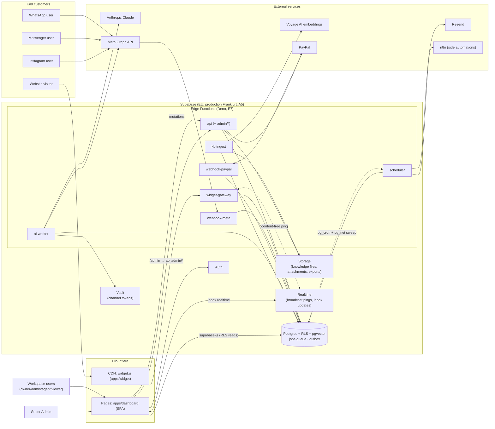

# Architecture

> Status: **P2 (Database & security) — schema applied to the Supabase dev project.**
> Decisions referenced as `A*`, `B`, `C*`, `P*` and `E*` (all approved) are defined in
> [`DECISIONS.md`](./DECISIONS.md). Edge Functions are designed here and built in the phase
> that needs each one (E7).
> Items marked **needs verification** depend on third-party behavior not yet confirmed
> against current vendor documentation.

## 1. System overview



**Core principle:** the customer-message path is `channel → edge function → Postgres (message +
job) → ai-worker → Claude → Postgres → channel`. n8n and email are _never_ in that path (A11);
the scheduler dispatches the outbox asynchronously.

## 2. Monorepo layout (A1)

```
apps/
  dashboard/        React + Vite + TS + Tailwind v4 + shadcn/ui (customer app + /admin)
  widget/           Embeddable chat widget (Preact in Shadow DOM — P8), built to one IIFE
packages/
  shared/           Runtime-agnostic constants/types (brand, locales, DB types, zod schemas)
  ai-engine/        Provider-agnostic AI pipeline (Deno-compatible, fetch-only)
supabase/
  migrations/       SQL migrations (timestamped)
  functions/        Edge Functions (Deno) + _shared/
  tests/database/   pgTAP suites (conventions, role matrix, isolation, limits, metering, queue)
scripts/db/         Management-API runner (remote migrate/test/types) + local test harness
docs/               Product + engineering docs (this folder)
```

`packages/*` must run in **both** the browser (Vite) and Deno (edge functions): no Node
built-ins, explicit `.ts` import extensions, `fetch` only. Supabase documents shared function
code in `supabase/functions/_shared/` and a `deno.json` per function (checked 2026-11-26);
whether `supabase functions deploy` bundles relative imports from **outside**
`supabase/functions` (e.g. `packages/shared`) is not stated — **needs verification** in P3 with
the first function (RISKS R-14). Fallback: a build step copies `packages/*` into
`supabase/functions/_shared/vendor/`.

## 3. Multi-tenancy model (C1, C2)

- **Tenant = `workspace`.** Every tenant-owned row carries `workspace_id`.
- Hierarchy: `workspace → branches (optional, Enterprise) → bots`. An organization layer can be
  added later as `organizations` + nullable `workspaces.organization_id` without touching
  tenant-scoped tables.
- **Composite foreign keys** `(workspace_id, id)` on core relations (bots, channels, customers,
  conversations, messages, orders, knowledge, billing…) make cross-tenant references impossible
  even for service-role code paths (pgTAP suite 05).
- **RLS is the security boundary** for every client read. Policies call `SECURITY DEFINER`
  helpers in the non-exposed `private` schema:
  `is_workspace_member`, `has_workspace_role`, `can_write` (role + workspace writable),
  `is_platform_admin`.
- **Column-level grants** restrict what clients can write (e.g. `workspaces.status`,
  `bots.status` and every `channels` column are never client-writable — "real statuses only",
  A14). Credentials live in `channel_credentials`, which no client role can read.
- **Workspace roles** (C2): Owner / Admin / Agent / Viewer. **Super Admin** lives in
  `platform_admins`, separate from workspace roles; admin operations run through the `api`
  function's `admin/*` routes with the service role and are always written to `audit_logs`.
- The full role × table matrix is in [`DATABASE.md §4`](./DATABASE.md) and tested by attempting
  every operation as every role (suite 04). Security controls: [`SECURITY.md`](./SECURITY.md).

| Capability                                                          | Owner |     Admin     | Agent | Viewer |
| ------------------------------------------------------------------- | :---: | :-----------: | :---: | :----: |
| View inbox, customers, analytics                                    |   ✓   |       ✓       |   ✓   |   ✓    |
| Reply / assign / close conversations, edit customers, update orders |   ✓   |       ✓       |   ✓   |        |
| Bots, knowledge, catalog, widget appearance, branches               |   ✓   |       ✓       |       |        |
| Channel connection requests                                         |   ✓   |       ✓       |       |        |
| Members & invitations                                               |   ✓   | ✓ (not owner) |       |        |
| Billing, plan changes, payment history                              |   ✓   |     view      |       |        |
| Data export / workspace deletion, API keys                          |   ✓   |   API keys    |       |        |

## 4. Edge Functions (E7)

| Function         | Auth                                                                                                                   | Responsibilities                                                                                                                                                                                                                                                                                                                                                                         | Built in  |
| ---------------- | ---------------------------------------------------------------------------------------------------------------------- | ---------------------------------------------------------------------------------------------------------------------------------------------------------------------------------------------------------------------------------------------------------------------------------------------------------------------------------------------------------------------------------------- | --------- |
| `api`            | Supabase JWT (dashboard) · API key (Enterprise) · `admin/*`: JWT + `platform_admins` row                               | Workspace creation (workspace + owner + trial atomically), invitations, member/role changes, connection requests, widget origins, signed upload URLs, agent replies + handoff, checkout, manual payment requests, data export/delete, Enterprise `/v1`; `admin/*`: workspaces, manual activation, overrides, credential entry (→ Vault), refunds, flags, dead-letter retry (`retry_job`) | P3 onward |
| `widget-gateway` | Bot `public_key` + exact Origin match (`allowed_origins`) + short-lived signed session token (`WIDGET_SIGNING_SECRET`) | Session, send message, fetch messages since cursor, install-verification ping                                                                                                                                                                                                                                                                                                            | P8        |
| `webhook-meta`   | Meta verify token (GET) + `X-Hub-Signature-256` HMAC (POST) — **needs verification**                                   | Verify → store `webhook_events` (idempotent) → normalize → upsert customer / conversation / message → enqueue `ai_reply` → ack; delivery statuses                                                                                                                                                                                                                                        | P13       |
| `webhook-paypal` | PayPal webhook signature verification — **needs verification**                                                         | Verify → store `webhook_events` → subscription / payment transitions + `billing_events`                                                                                                                                                                                                                                                                                                  | P12       |
| `ai-worker`      | Internal secret header (called by producers and the scheduler)                                                         | Jobs `ai_reply` (metering, AI engine, tools, fallback) and `deliver_message` (channel adapter `send`)                                                                                                                                                                                                                                                                                    | P7        |
| `kb-ingest`      | Internal secret header                                                                                                 | Jobs `ingest_knowledge_source`, `embed_chunks`, `reindex_structured_knowledge`                                                                                                                                                                                                                                                                                                           | P5        |
| `scheduler`      | Called by `pg_cron` + `pg_net` (~10 s sweep)                                                                           | `requeue_stuck_jobs`, wake-ups, usage-period rollover, trial expiry, grace → suspended, retention purge, analytics rollups + partitions, outbox dispatch (Resend + n8n), export/delete                                                                                                                                                                                                   | P7 / P10  |

Phase 01's single `worker` and separate `admin` function are retired (E7).

All functions share `_shared/` modules: request validation (zod), error envelope, Supabase
clients (user-scoped vs service-role), logging with correlation id, rate limiting, i18n error
messages.

## 5. Message flow

### 5.1 Website widget (fully automatic)

```mermaid
sequenceDiagram
  autonumber
  participant V as Visitor browser (widget.js)
  participant W as fn: widget-gateway
  participant DB as Postgres
  participant K as fn: ai-worker
  participant C as Claude
  participant R as Realtime

  V->>W: POST /widget/v1/messages (session token, client_message_id, text)
  W->>W: verify Origin ∈ allowed_origins, rate limit, validate
  W->>DB: upsert customer/identity/conversation; insert inbound message (idempotent)
  W->>DB: enqueue_job('ai_reply', key = 'ai_reply:'+message_id, queue 'ai')
  W-->>V: 202 {message_id, conversation_id, realtime_topic}
  W-)K: background kick (EdgeRuntime.waitUntil) — fallback: scheduler sweep
  K->>DB: claim_jobs('ai')
  K->>DB: consume_ai_reply(workspace, key)
  alt allowed
    K->>DB: load bot + active bot_config, profile, history/summary; match_kb_chunks()
    K->>C: messages.create (tools, cached system prefix)
    C-->>K: reply / tool_use (create_order, request_human_handoff…)
    K->>DB: execute tools server-side; insert outbound message + ai_run (billed)
  else quota exhausted / trial ended
    K->>DB: insert fallback message (not billed); emit platform_event
  end
  K->>R: broadcast {type:'new_message'} on realtime_topic (no content)
  R-->>V: ping
  V->>W: GET /widget/v1/conversations/:id/messages?after=cursor
```

### 5.2 Meta channels (after manual connection)

Same as above, except: inbound via `webhook-meta` (signature-verified, stored in
`webhook_events`, de-duplicated on `(channel_id, external_message_id)`), and delivery is a
`deliver_message` job that calls the channel adapter's `send()` with the token read from Vault
through `channel_credentials` (service role only). WhatsApp's 24-hour
customer-service window is tracked on `conversations.service_window_ends_at`; outside it, only
approved templates can be sent — **needs verification** (INTEGRATIONS.md §5).

### 5.3 Failure handling

- Generation or delivery failure → `release_ai_reply()` (quota returned) → `fail_job()` with
  exponential backoff (15 s → 1 h cap) → `dead` after `max_attempts`; dead `ai_reply` jobs send
  the bot's fallback message and surface in the inbox as "AI could not reply" (P7). A platform
  admin can re-queue a dead job with `retry_job()` (E1; audited; UI in P14).
- Worker crash → lock expires (`lock_expires_at`) → `requeue_stuck_jobs()` from the scheduler sweep.
- Duplicate webhooks/retries → unique indexes + `idempotency_key` make every step replay-safe.

## 6. Async jobs (A6, P1, P2)

- Queue = `public.jobs` with `claim_jobs()` using `FOR UPDATE SKIP LOCKED`, priorities, named
  queues (`ai` latency-sensitive, `default`, `maintenance`), visibility timeout, idempotency keys.
- Wake-ups (P2 proposal, E7 names): (a) the producing function kicks `ai-worker` in the
  background immediately; (b) `pg_cron` every ~10 s calls `scheduler` via `pg_net` as a safety
  net, which runs `requeue_stuck_jobs()` and wakes workers. pg_cron 1.6.4 and pg_net 0.20.4 are
  available on the dev project (checked P2); sub-minute schedules — **needs verification** in P7.
- Scheduled maintenance jobs (cron): usage-period rollover, trial expiry (7 days), 80 %/100 %
  alert dispatch, retention purge (plan `data_retention_days`, default 365; trial 30), deletion
  grace-period execution, daily admin report event for n8n.

## 7. Outbox, notifications and n8n (A10, A11)

`platform_events` is a transactional outbox written in the same transaction as the business
change. The `scheduler` dispatches each event:

- **Resend** for transactional email (admin notified of a new channel request, manual payment
  request, usage 80 %/100 %, trial ending/ended, invitations).
- **n8n** via a signed webhook (`N8N_SHARED_SECRET`, HMAC-SHA256 of body) for side automations
  (Slack/WhatsApp pings to the admin, daily/weekly reports).
  Failures retry independently per sink; the customer-message path never waits on either.

## 8. Channel adapter layer (A14)

```ts
// Design contract (§11; packages/channel-adapters in P7, Meta adapters in P13)
interface ChannelAdapter {
  readonly type: 'widget' | 'whatsapp' | 'messenger' | 'instagram';
  verifyWebhook(req: Request, rawBody: string): Promise<boolean>; // signature / verify token
  parseInbound(rawBody: string): Promise<NormalizedInboundEvent[]>;
  send(channel: Channel, msg: OutboundMessage, creds: ChannelCredentials): Promise<SendResult>;
  healthCheck(channel: Channel, creds: ChannelCredentials): Promise<HealthCheckResult>;
}
interface ConnectionProvisioner {
  // how a channel gets its credentials (connection_mode, E5)
  readonly mode: 'automatic' | 'manual' | 'oauth';
  provision(input: unknown): Promise<ProvisionResult>; // oauth = P13, flag meta_embedded_signup
}
```

Manual connection today and Embedded Signup v4 / Facebook Login later produce the **same**
`channels` row (only `connection_mode` differs) and the same `channel_credentials` + Vault
secret, so adapters and the message path don't change. A Meta channel only becomes
`connected` after a passing health check (database constraint). Details: [`INTEGRATIONS.md`](./INTEGRATIONS.md).

## 9. Billing & entitlements (A12, B)

Plans, prices, entitlements and one-time products are tables (seeded by migration, edited by
Super Admin). Effective entitlement = workspace override → plan entitlement → definition
default. Limits are enforced **in the database** (triggers + `consume_ai_reply`) so no code path
can bypass them (P4). Payment providers sit behind a `PaymentProvider` interface; PayPal first,
`manual` always available, Stripe later. Details: [`BILLING.md`](./BILLING.md).

## 10. AI engine (A7, A8)

`packages/ai-engine` exposes `GenerationProvider` (Claude) and `EmbeddingProvider` (Voyage)
interfaces, a retrieval module (hybrid pgvector + FTS with reciprocal-rank fusion), a prompt
builder with prompt-caching layout, a strict tool registry (`get_catalog`,
`check_working_hours`, `get_policy`, `create_order`, `confirm_order`, `create_reservation`,
`request_human_handoff`, `capture_contact_details`; E6/E13) and guardrails. Model routing (A15): Haiku 5.5 by default, escalating to
Sonnet 5.5 for complaints, low-confidence or complex multi-step questions; Opus 5.5 for
Enterprise contracts only. All of it is data in `ai_model_profiles`. Details: [`AI_ENGINE.md`](./AI_ENGINE.md).

## 11. Frontend architecture

- **Dashboard**: React 19, React Router, TanStack Query (server state), supabase-js (auth +
  RLS reads + Realtime), zod forms, i18next (`ar`/`en`, `dir` switched on `<html>`), Tailwind v4
  logical utilities, shadcn/ui primitives restyled with our tokens. `/admin` is a lazy-loaded
  route tree guarded by `platform_admins` (P7).
- **Widget**: Preact (P8) in a Shadow DOM, ≤ 35 kB gzip target, no cookies (visitor token in
  `localStorage` per site), RTL/LTR from bot/visitor language, accessible launcher and dialog.
- **Design system**: [`DESIGN_SYSTEM.md`](./DESIGN_SYSTEM.md); tokens in
  `apps/dashboard/src/styles/tokens.css`.

## 12. Security

Summary below; full controls, the role matrix and the P2 findings are in
[`SECURITY.md`](./SECURITY.md).

| Concern          | Control                                                                                                                                                                                                   |
| ---------------- | --------------------------------------------------------------------------------------------------------------------------------------------------------------------------------------------------------- |
| Tenant isolation | RLS on every table, composite FKs, pgTAP suites 01–08 in CI and on the dev project                                                                                                                        |
| Secrets          | Only `VITE_*` publishable values in the browser. Service-role key, Anthropic/Voyage/PayPal/Resend/Meta secrets only as Edge Function secrets. Channel tokens in Supabase Vault (P5)                       |
| Webhooks         | Signature verification before parsing; raw event stored; idempotent processing                                                                                                                            |
| Widget abuse     | Origin allow-list (empty = disabled), per-key + per-IP + per-visitor rate limits, message size caps, optional Turnstile later — **needs verification** of Cloudflare Turnstile fit                        |
| Prompt injection | Customer text is always user-role content; tools validate inputs server-side; prices/IDs resolved from DB; no tool can read other tenants' data (workspace id injected server-side, never from the model) |
| Audit            | `audit_logs` (append-only trigger) for admin actions, role changes, billing changes, credential changes                                                                                                   |
| PII & retention  | Retention purge job; per-workspace export/delete (C10); EU region (A5)                                                                                                                                    |
| API keys         | Stored as SHA-256 hash with display prefix; scopes; revocable                                                                                                                                             |

## 13. Environments

| Env        | Supabase                                     | Dashboard                | Widget                            | Payments       | Notes                   |
| ---------- | -------------------------------------------- | ------------------------ | --------------------------------- | -------------- | ----------------------- |
| local      | Supabase CLI (`supabase start`) + `seed.sql` | Vite dev server          | Vite dev server                   | PayPal sandbox | seed data, no real Meta |
| staging    | dev project `ai-crm-dev` (`eu-west-1`, §21)  | Cloudflare Pages preview | CDN `/staging/`                   | PayPal sandbox | Meta test numbers       |
| production | new project (EU · Frankfurt, A5)             | Cloudflare Pages         | CDN `/v1/` (immutable, versioned) | PayPal live    | —                       |

Environment and migration procedures: [`DEPLOYMENT.md`](./DEPLOYMENT.md). Deployment itself is P17.

## 14. Observability

- Correlation id per request/job propagated into `ai_runs`, `jobs`, logs.
- `ai_runs`: model, served model, tokens (incl. cache read/write), latency, cost, stop reason.
- Admin health views (P14): queue depth/age, dead jobs, webhook failures, delivery error
  rate, AI p95 latency, per-workspace cost vs revenue.
- Error tracking provider (e.g. Sentry) — to be chosen; **needs verification** of Deno support.
