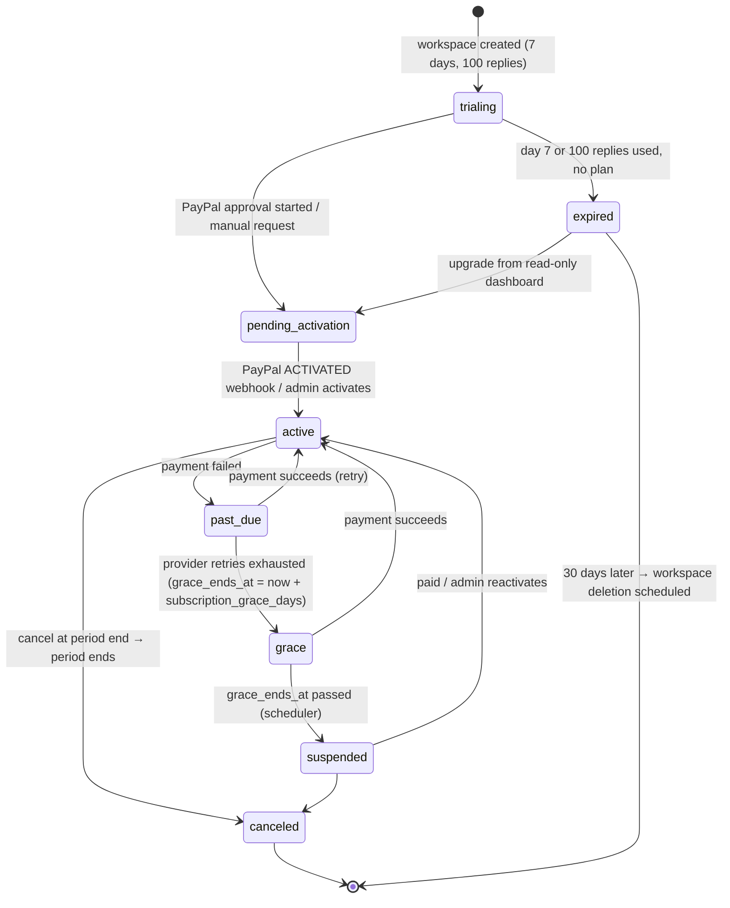

# Billing Design

Approved inputs: decisions A12, B, C5–C8, E4, E13 in [`DECISIONS.md`](./DECISIONS.md). Schema:
`supabase/migrations/…000800_billing_plans_usage.sql`, functions in `…001000`, seed in `…001200`
(applied to the dev project in P2; billing flows are built in P12).
PayPal API details are **needs verification** throughout; the design only depends on capabilities
PayPal is expected to offer (hosted subscription approval, webhooks, one-time capture, refunds).

## 1. Principles

1. **Plans are data.** Prices, limits and features live in `plans`, `plan_prices`,
   `plan_entitlements`, `one_time_products`; Super Admin edits them. No plan code in app logic —
   code asks for entitlements by key.
2. **Billable unit = AI-generated reply.** Inbound messages, human replies, fallback messages,
   playground replies are never billed — enforced in the database: `consume_ai_reply` refuses
   `is_test` AI runs and a test run can never be marked `billed` (suite 02).
3. **The database enforces limits** (triggers + `consume_ai_reply`), so every path is covered.
4. **Provider-agnostic.** PayPal and `manual` today, Stripe later, behind one interface.
5. **Full history.** Every money movement is a `payment_transactions` row (C8); every billing state
   change is an append-only `billing_events` row (§14); manual overage invoices are
   `invoices_records`. VAT and PDF invoices deferred.

## 2. Plan catalog (seeded)

| Code         | Monthly       | Annual (10×) | AI replies                       | Bots | Users | Meta channels   | FAQs / catalog items / files (F3) | Features                                                          |
| ------------ | ------------- | ------------ | -------------------------------- | ---- | ----- | --------------- | --------------------------------- | ----------------------------------------------------------------- |
| `trial`      | free (7 days) | —            | 100 total                        | 1    | 1     | 0 (widget only) | 30 / 50 / 5                       | basic                                                             |
| `starter`    | $39           | $390         | 1,000 / mo, hard stop            | 1    | 1     | 1               | 200 / 500 / 20                    | basic analytics                                                   |
| `growth`     | $99           | $990         | 5,000 / mo + overage $10 / 1,000 | 2    | 3     | 3               | 1,000 / 2,000 / 100               | advanced analytics, classification, orders, reservations, handoff |
| `enterprise` | from $299     | from $2,990  | custom (default 20,000)          | ∞    | ∞     | ∞               | custom (unlimited by default)     | + multi-branch, API access, white-label widget                    |

Content limits are the entitlements `max_faqs`, `max_catalog_items` and `knowledge_files_max`
(plus `knowledge_file_max_mb` per upload), enforced by insert triggers that raise
`plan_limit:<key>:<limit>` (suite 02).

One-time product: `meta_channel_connection` — **$49 per channel**, refundable (C6).
Effective entitlement = `workspace_entitlement_overrides` (Enterprise custom / admin
adjustments, optional expiry) → `plan_entitlements` → `entitlement_definitions.default_value`.

> AI cost (decision A15): every plan runs on the `standard` profile — Haiku 5.5 with Sonnet 5.5
> escalation. Estimated AI cost at a 15 % escalation rate ≈ $2.1 / 1,000 replies: Starter ≈ 5 %
> and Growth ≈ 11 % of revenue, overage ≈ 21 % of its $10 price; still ≤ ~17 % of plan revenue at
> the 30 % escalation alert. Opus 5.5 (`premium`, ≈ $18 / 1k) is Enterprise-only and must be
> priced in the contract. See [`AI_ENGINE.md §9`](./AI_ENGINE.md#9-cost-model-with-routing-estimates).

## 3. Provider abstraction

```ts
interface PaymentProvider {
  readonly id: 'paypal' | 'manual' | 'stripe';
  createSubscriptionCheckout(i: {
    workspaceId;
    planPriceId;
    returnUrl;
    cancelUrl;
  }): Promise<{ approveUrl: string; providerSubscriptionId: string }>;
  changeSubscriptionPlan(i: { subscription; newPlanPriceId }): Promise<{ approveUrl?: string }>;
  cancelSubscription(i: { subscription; atPeriodEnd: boolean }): Promise<void>;
  createOneTimeCheckout(i: {
    workspaceId;
    productCode;
    referenceId;
    returnUrl;
    cancelUrl;
  }): Promise<{ approveUrl: string; providerOrderId: string }>;
  captureOneTime(i: {
    providerOrderId;
  }): Promise<{ providerRef: string; amountCents: number; currency: string }>;
  refund(i: { transaction; amountCents? }): Promise<{ providerRef: string }>;
  verifyWebhook(req: Request, rawBody: string): Promise<boolean>;
  normalizeWebhook(payload: unknown): NormalizedBillingEvent[];
}
```

`provider_price_refs` maps each `plan_prices` / `one_time_products` row to the provider's id
(PayPal billing-plan id, later Stripe price id) per environment (sandbox/live). `manual` is a
provider too: its "checkout" is a `manual_payment_requests` row handled by Super Admin.

## 4. Lifecycle state machine



Workspace status follows: `trialing/active/past_due/grace` → workspace `active` (AI keeps
replying; `consume_ai_reply` allows `grace`, suite 02); `expired/suspended/canceled` → workspace
`read_only` (dashboard visible, writes blocked by `private.can_write`, AI stops, fallback messages
sent). `grace` (E4) lasts `platform_settings.subscription_grace_days` (seeded 3); the schema
requires `grace_ends_at` whenever the status is `grace`. Every transition writes a
`billing_events` row (`from_status`, `to_status`, `source`, actor, webhook event).

## 5. PayPal flows (needs verification of API names/fields)

### 5.1 Subscribe / upgrade

1. Owner clicks _Subscribe_ → `POST /billing/checkout {plan_code, interval}`.
2. `api` looks up the plan price + PayPal plan id, creates a PayPal subscription with
   `custom_id = workspace_id` and return/cancel URLs; inserts `subscriptions(status =
pending_activation, provider = paypal, provider_subscription_id)` **beside** the live trial /
   plan (one pending row per workspace, separate unique index); returns `approve_url`. A pending
   row grants nothing: entitlements, usage periods and metering only come from a trialing /
   active / past_due / grace subscription, so the trial keeps working and nothing unlocks early.
3. Customer approves on PayPal → returns to the dashboard ("activating…" — the UI shows the
   _real_ status, polling until the webhook arrives).
4. Webhook _subscription activated_ → previous live subscription (trial) is ended, new one
   `active`, `current_period_start/end` set from PayPal, new usage period opened, workspace
   `active`, `payment_transactions` row on the first _payment completed_ event.

### 5.2 Webhook → state mapping

| PayPal event (names to verify)   | Effect                                                                              |
| -------------------------------- | ----------------------------------------------------------------------------------- |
| subscription activated           | `pending_activation → active`; open usage period; event `subscription.activated`    |
| payment sale/capture completed   | `payment_transactions(subscription_payment, completed)`; advance `current_period_*` |
| payment failed                   | `active → past_due`; email owner; event for n8n                                     |
| retries exhausted                | `past_due → grace` (+ `grace_ends_at`); email owner                                 |
| subscription suspended           | `→ suspended`; workspace `read_only`                                                |
| subscription cancelled / expired | `→ canceled` (at period end if scheduled); workspace `read_only` at end             |
| capture refunded                 | `payment_transactions(refund)`; connection-fee status `refunded`                    |

All events are inserted into the generic `webhook_events` inbox first (unique
`(provider, event_id)`, `status received → processed | failed | ignored`, `attempts`),
processed idempotently, and out-of-order events are handled by comparing PayPal's resource
state, not by trusting arrival order. Each resulting state change writes a `billing_events` row
pointing at the webhook event.

### 5.3 Plan changes

- **Upgrade** (e.g. Starter → Growth): immediate. Entitlements switch at once; the current
  usage period's `ai_replies_included` is raised to the new plan's value (used count kept).
  PayPal plan revision vs. cancel-and-resubscribe with proration — **needs verification**;
  v1 fallback: new subscription, old one cancelled, credit handled manually by admin.
- **Downgrade**: at period end. Before it applies, the UI lists what must be reduced (bots,
  users, channels above the new limits); triggers prevent re-adding beyond limits, existing
  excess resources are disabled (not deleted) at switch time.
- **Annual ↔ monthly**: treated as a plan-price change at period end.

## 6. Manual payment path (A12)

1. Customer chooses _Pay manually / contact us_ → `manual_payment_requests(open)` with plan or
   product, contact details, preferred method, message.
2. Outbox event `manual_payment.requested` → Resend email to `admin_notification_emails` +
   n8n webhook.
3. Super Admin contacts the customer (status `contacted`), receives payment off-platform.
4. Admin activates: `POST /admin/v1/workspaces/{ws}/subscriptions/activate` with plan,
   period, optional custom amount, and transaction details → `subscriptions(provider = manual,
status = active, activated_by)`, `payment_transactions(provider = manual, completed)`,
   `billing_events(subscription.manual_activated, source = admin)`, request `activated`, audit
   log, owner notified.
5. Renewal: a `subscription.renewal_due` event 7 days before `current_period_end` reminds admin
   and customer; if not renewed by period end → `past_due` → `grace` → `suspended` (workspace
   read-only).

Enterprise contracts use the same path with `custom_amount_cents` and entitlement overrides.

## 7. Usage metering & alerts

- **Usage period** = monthly window anchored to the subscription start (P11) — also on annual
  plans, computed in UTC (a Jan 31 anchor gives Feb 28 → Mar 31). Trial = one period from
  creation to `trial_ends_at`. Periods belong to one subscription, so an upgrade opens a fresh
  period on the new plan immediately.
- `consume_ai_reply(workspace, 'ai_reply:'+message_id)` runs _before_ calling Claude:
  - row-locks the period, checks included replies, allows overage only if `overage_enabled`;
  - writes a `usage_events` ledger row (idempotent key);
  - on failure the worker calls `release_ai_reply(key)` (quota returned, ledger row `-1`);
  - a retry with the same key after a release is a **new reservation** (`<key>:r2`, …) with all
    checks, so every delivered reply is counted; replaying an active reservation is idempotent;
    a key is bound to its workspace.
- **Alerts at 80 % and 100 %** of included replies: inserted once per period into
  `usage_alerts` and the outbox (`usage.threshold_reached`) → email to owner/admins + in-app
  banner. For Starter, 100 % = hard stop with upgrade prompt; for Growth, 100 % = overage starts.
- **Overage (Growth/Enterprise)**: counted in `usage_periods.overage_replies`. At period close,
  `usage_period_rollover` computes `ceil(overage_replies / overage_unit_size) ×
overage_unit_price_cents` and queues it for Super Admin, who issues a manual invoice → `invoices_records(kind = overage,
status draft → issued → paid)` (one live overage invoice per usage period, unique index);
  payment is recorded as `payment_transactions(type = overage, provider = manual)` (C5).
  Automated overage charging is a later phase.
- Inbound messages counted in `usage_periods.inbound_messages` for analytics only.

## 8. Trial lifecycle (C7)

| When                                                | What happens                                                                                                                                                                        |
| --------------------------------------------------- | ----------------------------------------------------------------------------------------------------------------------------------------------------------------------------------- |
| Workspace created                                   | `subscriptions(trialing, trial_ends_at = now + 7 days)`, usage period with 100 replies                                                                                              |
| 80 % (80 replies) / day 5                           | Upgrade reminder email + in-app banner                                                                                                                                              |
| 100 replies **or** day 7 (`trial_expiry_check` job) | Subscription `expired`; workspace `read_only`; AI stops; widget keeps accepting messages and replies with the bot's configurable `fallback_message`; dashboard shows upgrade prompt |
| Day 7 + 23 / + 29                                   | "Your data will be deleted" emails (T-7, T-1)                                                                                                                                       |
| Day 7 + 30                                          | Workspace deletion scheduled (`data_requests(kind = delete)`) unless upgraded                                                                                                       |

## 9. One-time Meta connection fee ($49 / channel, C6)

1. Customer submits a channel connection request and chooses PayPal or manual.
2. PayPal: one-time checkout (`reference_id = request_id`) → capture → `payment_transactions
(connection_fee, completed)`, `channel_connection_requests.fee_status = paid`. Manual: a
   `manual_payment_requests` row linked to the request; admin records the payment.
3. Admin starts work only when `fee_status ∈ {paid, waived}` (admin may waive).
4. If the connection cannot be completed → request `rejected` and a refund:
   PayPal refund API or manual refund record (`refund_of_id` links the original), `fee_status =
refunded`, customer notified.

## 9b. Billing records after workspace deletion (F1)

`soft_delete_workspace()` keeps `billing_events`, `payment_transactions`, `invoices_records` (and
PayPal webhook events as evidence), detached from tenant content: invoices keep their billing
period as a snapshot, subscription links are cleared, the workspace row keeps only
`retained_billing_identity` (name, slug, country). Former members cannot read them. They are
removed with the tombstone after `billing_record_retention_days` (default 1825 = 5 years) by
`purge_deleted_workspaces()`. Legal retention per country remains **needs verification**.

## 10. Billing UI states (real data only)

The dashboard billing page reads `GET /billing` and shows exactly what the DB says: plan,
status badge (`Trial · 3 days left`, `Active`, `Payment failed`, `Grace · 2 days left`,
`Read-only`), usage meter
(used / included, overage count), next renewal date, history table. No optimistic "active"
before the webhook confirms.

## 11. Deferred (documented, not built)

VAT/tax calculation, PDF invoices, automated overage charging, Stripe provider, coupons,
proration credits, multi-currency pricing, dunning sequences beyond the provider's own retries.
