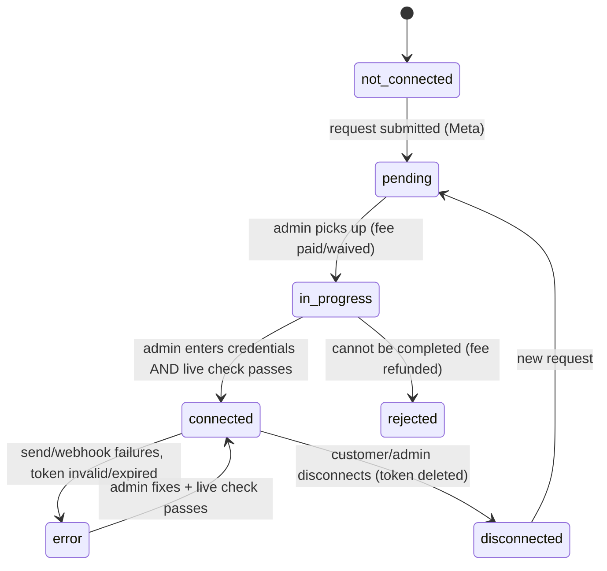

# Channels & the Connect Section

Approved: A14. Schema: `channel_connections`, `channel_connection_requests`,
`channel_connection_events`, `widget_configs` (migration `…000300`). Plan gating:
`allowed_channel_types` + `max_meta_channels` (enforced by triggers).

**Rule: never fake a working integration.** Every status shown in the UI is the stored status
of a real row, set by the system or an admin after a verified check.

## 1. Connect section (UI spec — built in Phase 03/06)

Four cards, always in this order: **Website Widget · WhatsApp · Messenger · Instagram**.

| Card element   | Widget                                                                            | WhatsApp / Messenger / Instagram                                                                                                         |
| -------------- | --------------------------------------------------------------------------------- | ---------------------------------------------------------------------------------------------------------------------------------------- |
| Header         | icon, name, one-line value prop (ar/en)                                           | same                                                                                                                                     |
| Status badge   | `Connected` / `Disabled` / `Not set up`                                           | `Not connected` · `Pending` · `In progress` · `Connected` · `Error` · `Disconnected` · `Rejected`                                        |
| Plan gate      | always available                                                                  | if not in plan → lock + "Available on Starter and above" / limit reached → "Upgrade to add more channels"                                |
| Primary action | _Customize & install_                                                             | `Not connected` → _Request connection_ (form) · `Pending/In progress` → _View request_ · `Connected` → _Manage_ · `Error` → _View issue_ |
| Details        | install snippet, allowed origins, appearance, live preview, last message received | connected account (phone/page/handle), connected at, last inbound/outbound, request timeline (non-internal events), fee status           |

Status badge colors and copy are defined in the design system (`DESIGN_SYSTEM.md §8`).
"Last message received" timestamps come from `last_inbound_at` — the strongest signal that a
connection actually works.

## 2. Status machines

### Connection (`channel_connections.status`)



Widget connections are created `connected` automatically with the bot (method `automatic`);
customers can disable/enable them (`widget_configs.is_enabled`).

### Request (`channel_connection_requests.status`)

`pending → in_progress → completed | rejected`, or `pending → canceled` by the customer.
Every transition appends a `channel_connection_events` row (customer-visible unless
`is_internal`).

## 3. Manual Meta flow (now)

```mermaid
sequenceDiagram
  autonumber
  actor O as Owner/Admin
  participant D as Dashboard
  participant API as fn: api
  participant DB as Postgres
  participant W as fn: worker
  participant M as Resend / n8n
  actor SA as Super Admin
  participant ADM as fn: admin
  participant G as Meta Graph API

  O->>D: Request connection (form)
  D->>API: POST /channel-requests (+ payment choice)
  API->>DB: insert request (trigger checks plan) · status pending · event row · outbox
  API-->>D: request + PayPal approve URL or manual instructions
  W->>M: channel_request.created → email + n8n
  SA->>ADM: set in_progress (fee paid/waived)
  SA->>ADM: connect {ids, access token}
  ADM->>G: live check (read phone number / page) — needs verification
  alt check OK
    ADM->>DB: token → Vault; channel_connections status connected; request completed
  else check fails
    ADM-->>SA: error shown, nothing marked connected
  end
  W->>M: channel_request.status_changed → customer email
```

Form fields per channel (validated by zod in `api`, stored in `details`):

| WhatsApp                                                                                                                                                          | Messenger                                                                  | Instagram                                                                  |
| ----------------------------------------------------------------------------------------------------------------------------------------------------------------- | -------------------------------------------------------------------------- | -------------------------------------------------------------------------- |
| Business name, display name, phone number to connect (E.164), does it already use WhatsApp Business App/API?, Meta Business Manager id (optional), contact person | Facebook Page URL, Meta Business Manager id (optional), page admin contact | Instagram handle (professional account), linked Facebook Page URL, contact |

The form explains, in both languages, what the customer will need to do (e.g. grant access to
their Meta Business account) — wording to be verified against Meta's current requirements.

## 4. Adapter contract

See [`ARCHITECTURE.md §8`](./ARCHITECTURE.md#8-channel-adapter-layer-a14). Each adapter:

- `parseWebhook()` — verifies signature, maps events to `NormalizedInboundEvent`, never throws on
  unknown event types (logs them as `unsupported`).
- `send()` — reads the token from Vault via `credentials_secret_id`, sends text/media, returns
  the provider message id; maps provider errors to `retryable | permanent | auth_error`
  (`auth_error` moves the connection to `error`).
- `capabilities()` — e.g. WhatsApp: templates required outside the service window; Instagram/
  Messenger: messaging-window rules (**needs verification** for each platform's current policy).

## 5. Platform specifics to verify before Phase 06 (all **needs verification**)

| Topic                                              | WhatsApp Cloud API                              | Messenger                        | Instagram                  |
| -------------------------------------------------- | ----------------------------------------------- | -------------------------------- | -------------------------- |
| Account identifier stored as `external_account_id` | phone number id                                 | page id                          | IG professional account id |
| Business identifier (`external_business_id`)       | WABA id                                         | business id                      | business id                |
| Token type & expiry                                | system-user / business token                    | page access token                | page/IG token              |
| Webhook subscription                               | per app + WABA                                  | page subscription                | page/IG subscription       |
| Messaging window                                   | 24 h customer-service window; templates outside | standard messaging window + tags | similar window rules       |
| Graph API version                                  | pinned via `META_GRAPH_API_VERSION`             | same                             | same                       |
| App review / permissions                           | required scopes for business messaging          | pages messaging                  | instagram messaging        |

## 6. Embedded Signup v4 — later, without rewrites

What already exists for it:

- `connection_method = 'embedded_signup'` enum value.
- Credential storage in Vault referenced by `credentials_secret_id` (same as manual).
- `external_account_id` / `external_business_id` / `config` hold what the signup returns
  (phone number id, WABA id, business id — **needs verification** of v4's exact outputs).
- `ConnectionProvisioner` interface: manual provisioner (admin form) today; an
  `EmbeddedSignupProvisioner` later exchanges the code from the Meta JS SDK popup for a token
  server-side and calls the same `upsertConnection()`.

What will be added then: Meta JS SDK on the Connect page (feature-flagged), an `api` route to
complete the exchange, webhook auto-subscription. The adapters, message pipeline, schema and
billing stay unchanged. The $49 fee may be dropped for self-serve connections — that is a data
change (`one_time_products.is_active`).

## 7. Website widget (automatic)

- Created with the first bot: `channel_connections(widget, automatic, connected)` +
  `widget_configs` with a random `public_key`.
- Install snippet (shown in dashboard):
  `<script src="https://<cdn>/v1/widget.js" data-key="wk_…" async></script>`
- The widget refuses to load until at least one exact origin is in `allowed_origins`; the
  dashboard pre-fills the domain the owner typed and shows a live "last seen on <origin>"
  indicator from real requests.
- Shadow DOM isolation, RTL/LTR from the bot/visitor language, logical position (`start`/`end`),
  keyboard and screen-reader accessible, ≤ 35 kB gzip target (P8).
