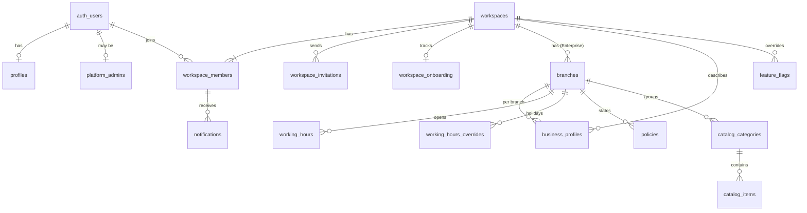
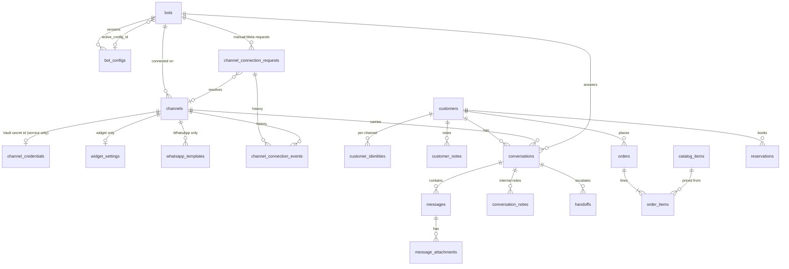
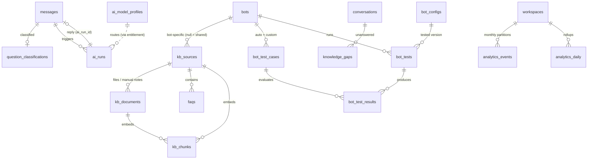
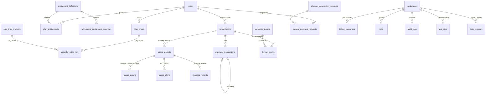

# Database Design

Postgres 17 (Supabase) with RLS on **every** table and pgvector for retrieval.
Source of truth: [`supabase/migrations/`](../supabase/migrations). Tests:
[`supabase/tests/database/`](../supabase/tests/database). Names follow DECISIONS §E (E9).

> **Validation status (P3, 2026-11-26).** All 18 migrations are applied to the Supabase dev
> project `ai-crm-dev` (Postgres 17.12, region `eu-west-1`) and recorded in
> `supabase_migrations.schema_migrations`. The full pgTAP suite passes there (10 files,
> **602/602**) and on the Supabase CLI local stack (602/602, `supabase db lint` clean). Real
> `auth.uid()`, default grants, Vault, the REST layer and (P3) the auth trigger with real
> sign-ups were exercised. Applied migrations are frozen: changes go into new migration files.

## 1. Migration index

| File                                           | Contents                                                                                                                                                                                                                                                                                                                                                                                                                                        |
| ---------------------------------------------- | ----------------------------------------------------------------------------------------------------------------------------------------------------------------------------------------------------------------------------------------------------------------------------------------------------------------------------------------------------------------------------------------------------------------------------------------------- |
| `…000100_extensions_and_helpers`               | `extensions` (pgcrypto, vector, pg_trgm), `private` schema, all enums, `set_updated_at`, `is_i18n_text`, `reject_mutation` (append-only guard), default `anon` table revoke                                                                                                                                                                                                                                                                     |
| `…000200_identity_tenancy`                     | profiles, platform_admins, workspaces (+ `category`), workspace_members, workspace_invitations, branches, workspace_onboarding + RLS helpers                                                                                                                                                                                                                                                                                                    |
| `…000300_bots_channels`                        | business_profiles, working_hours, working_hours_overrides, policies, bots, channels, channel_credentials, whatsapp_templates, channel_connection_requests, channel_connection_events, widget_settings                                                                                                                                                                                                                                           |
| `…000400_customers_conversations_messages`     | customers, customer_identities, conversations, messages, message_attachments, handoffs, customer_notes, conversation_notes                                                                                                                                                                                                                                                                                                                      |
| `…000500_knowledge_catalog`                    | kb_sources, kb_documents, faqs, kb_chunks (vector 1024 + tsvector + HNSW), catalog_categories, catalog_items, knowledge_gaps                                                                                                                                                                                                                                                                                                                    |
| `…000600_orders_reservations`                  | orders (+ `delivery_fee_cents`), order_items, reservations                                                                                                                                                                                                                                                                                                                                                                                      |
| `…000700_ai_runs_analytics`                    | ai_model_profiles, ai_model_prices, bot_configs (versioned), ai_runs (+ `is_test`), question_classifications                                                                                                                                                                                                                                                                                                                                    |
| `…000750_analytics`                            | analytics_events (monthly partitions in schema `private` + default), `private.ensure_analytics_partitions()`, analytics_daily                                                                                                                                                                                                                                                                                                                   |
| `…000760_bot_tests`                            | bot_test_cases, bot_tests, bot_test_results                                                                                                                                                                                                                                                                                                                                                                                                     |
| `…000800_billing_plans_usage`                  | entitlement_definitions, plans, plan_prices, one_time_products, provider_price_refs, plan_entitlements, workspace_entitlement_overrides, subscriptions (+ `grace`), billing_customers, payment_transactions, manual_payment_requests, usage_periods, usage_events, usage_alerts, billing_events, invoices_records                                                                                                                               |
| `…000900_jobs_events_audit`                    | jobs (+ `retry_count`), webhook_events, platform_events, audit_logs (append-only), internal_notes, api_keys, data_requests, platform_settings, notifications, feature_flags                                                                                                                                                                                                                                                                     |
| `…001000_functions_triggers`                   | entitlements, limit triggers, usage periods, `consume_ai_reply` / `release_ai_reply`, queue RPCs + `retry_job`, `match_kb_chunks`, order numbers, message bookkeeping (preview), re-index triggers, feature flags, bot config versions, Vault cleanup, channel-type guards, grant lockdown                                                                                                                                                      |
| `…001100_storage`                              | buckets `knowledge-files`, `attachments`, `exports`, `public-assets` + read policies                                                                                                                                                                                                                                                                                                                                                            |
| `…001200_seed_plans`                           | entitlement keys, Trial/Starter/Growth/Enterprise, prices, $49 connection fee, model profiles, model prices, platform settings (incl. `subscription_grace_days` = 3), feature flag `meta_embedded_signup` (OFF), final `anon` privilege sweep                                                                                                                                                                                                   |
| `…20261126000100_p2_review_fixes`              | Review fixes (forward migration): race-safe limits, limit-leak guard, immutable `workspace_id`, entitling subscriptions, per-subscription usage periods, re-reservation after release, manual connect count, bot/file-source delete revoked, handoff gate, storage read policies removed, disconnect cleanup, hardening (privileges, size caps, paths, currency, i18n, FKs, queue ownership, retrieval)                                         |
| `…20261126000200_retention_and_content_limits` | Owner decisions F1 + F3: soft delete (`soft_delete_workspace`, `purge_deleted_workspaces`, `workspaces.purge_after` / `retained_billing_identity`, invoice period snapshot, `billing_record_retention_days`), content limits `max_faqs` / `max_catalog_items` / `knowledge_files_max` + upload size triggers                                                                                                                                    |
| `…20261126000300_p3_auth_workspaces`           | P3: profile auto-creation on sign-up (`private.handle_new_user`, name + locale from metadata as display data only) and email sync; `profiles.email` (read-only) + column update grants; invitation `email_status` / `locale` / `accepted_by` and `token_hash` no longer client-selectable; settings `max_trial_workspaces_per_user` (1) and `invitation_expiry_days` (7); service-role RPCs below; `private.rate_limit_hits` + `hit_rate_limit` |
| `…20261126000400_p3_review_fixes`              | P3 review fixes: passwords set before email confirmation are cleared at confirmation (`auth.users` trigger, account-takeover fix); `accept_invitation` needs a writable workspace and an inviter who is still owner/admin; removing/demoting a member revokes their open invitations; `release_assignments` only touches open work                                                                                                              |

`supabase/seed.sql` holds local demo data only (CLI local stack and CI); it is never applied to
the dev or production project.

## 2. Conventions

- `uuid` PKs (`gen_random_uuid()`); `bigint identity` for append-only logs and queues.
- Every tenant table has `workspace_id NOT NULL` (+ an index led by it); core relations use
  composite FKs `(workspace_id, x_id)` so a row can never point at another tenant's row, whatever
  role writes it (suite 05). Platform tables where `workspace_id` is optional: `jobs`,
  `platform_events`, `audit_logs`, `internal_notes`, `webhook_events`, `feature_flags` (global rows).
- `created_at` / `updated_at timestamptz` with the `private.set_updated_at()` trigger.
- Localized content as `jsonb {"ar": "...", "en": "..."}` checked by `private.is_i18n_text()`.
- Money as `bigint` minor units + `char(3)` currency (P14); internal AI cost in `cost_micros`.
- Stable vocabularies are enums; anything plan- or price-related is data.
- `workspace_id` is immutable on every tenant table (trigger `*_workspace_immutable`, 0013).
- Plan-limit triggers take a per-workspace advisory lock (race-safe, P4) and apply the RLS write
  rule first, so another tenant's plan never leaks through a limit error.
- Usage periods belong to a subscription (unique `(workspace_id, subscription_id,
period_start)`); only trialing / active / past_due / grace subscriptions grant entitlements.
- Append-only tables (`audit_logs`, `billing_events`, `bot_configs`) reject UPDATE/DELETE with
  `private.reject_mutation()`; changes from FK actions (workspace deletion) are let through.
- Sandbox rows (`is_test` on conversations / messages / ai_runs) are never billed or counted.
- Client writes are allowed only where there are no side effects; otherwise rows are written by
  Edge Functions with the service role. Column-level INSERT/UPDATE grants narrow what clients
  can set (e.g. bots: never `status`, `readiness_score`, `public_key`).
- **ON DELETE** policy: tenant data cascades from `workspaces`; optional references use
  `set null (column)` so `workspace_id` is never nulled; audit rows survive workspace deletion
  with `workspace_id = null`; deleting a channel removes its credential row and Vault secret.

## 3. Entity-relationship diagrams

Every table except the platform catalogue also references `workspaces` (omitted from the
diagrams for readability).

### 3.1 Tenancy and business data

### 3.2 Bots, channels and conversations

### 3.3 Knowledge, AI, analytics and playground

### 3.4 Billing, usage and platform

## 4. RLS matrix (client roles)

`R` = select · `I` = insert · `U(cols)` = update of listed columns only · `D` = delete ·
`—` = no client access (service role / Edge Functions only). O = owner, A = admin, G = agent,
V = viewer. Any user of another workspace and `anon` get nothing on tenant tables. **Suite 04
(`04_role_matrix.test.sql`) checks this whole table by attempting every operation as every role**
and fails when a new tenant table is not in it.

| Table                                                                                                                                                                                                            | O                                                             | A    | G    | V    | Notes                                                                                 |
| ---------------------------------------------------------------------------------------------------------------------------------------------------------------------------------------------------------------- | ------------------------------------------------------------- | ---- | ---- | ---- | ------------------------------------------------------------------------------------- |
| profiles                                                                                                                                                                                                         | R self + team, U self (name, avatar, locale, theme, numerals) | same | same | same | created by the auth trigger; `email` synced, never client-writable (P3)               |
| platform_admins                                                                                                                                                                                                  | R self                                                        | same | same | same | lets the UI know whether the user is a platform admin                                 |
| workspaces                                                                                                                                                                                                       | R, U(name, locale, tz, country, category, logo)               | same | R    | R    | status / retention never client-writable                                              |
| workspace_members                                                                                                                                                                                                | R                                                             | R    | R    | R    | changes via `api` (owner rules, `max_users`)                                          |
| workspace_invitations                                                                                                                                                                                            | R (not `token_hash`)                                          | R    | —    | —    | created / renewed / revoked / accepted via `api` (P3)                                 |
| workspace_onboarding                                                                                                                                                                                             | R I U                                                         | same | R    | R    | wizard progress (P4)                                                                  |
| branches, business_profiles, working_hours, working_hours_overrides, policies                                                                                                                                    | R I U D                                                       | same | R    | R    | limits enforced by triggers; changes enqueue re-indexing                              |
| bots                                                                                                                                                                                                             | R I U (not status / readiness / public_key)                   | same | R    | R    | readiness gate server-side (P11); delete via `api` only                               |
| bot_configs                                                                                                                                                                                                      | R I                                                           | R I  | R    | R    | immutable versions                                                                    |
| channels, channel_connection_requests, whatsapp_templates, customer_identities                                                                                                                                   | R                                                             | R    | R    | R    | real statuses only (A14); writes via functions                                        |
| channel_connection_events                                                                                                                                                                                        | R (non-internal)                                              | same | same | same |                                                                                       |
| **channel_credentials**                                                                                                                                                                                          | —                                                             | —    | —    | —    | **service role only**; token in Vault                                                 |
| widget_settings                                                                                                                                                                                                  | R, U(appearance)                                              | same | R    | R    | origins via `api`                                                                     |
| customers                                                                                                                                                                                                        | R, U(CRM fields)                                              | same | same | R    |                                                                                       |
| customer_notes, conversation_notes                                                                                                                                                                               | R I, U/D own                                                  | same | same | R    | author = caller                                                                       |
| conversations                                                                                                                                                                                                    | R, U(assigned_to, handler)                                    | same | same | R    | assignee must be an active owner/admin/agent; `handler = human` needs `human_handoff` |
| messages, message_attachments, handoffs, order_items, question_classifications                                                                                                                                   | R                                                             | R    | R    | R    | writes via functions                                                                  |
| kb_sources                                                                                                                                                                                                       | R I U D (never `file`)                                        | same | R    | R    | file sources created/deleted via `api` (storage cleanup)                              |
| kb_documents                                                                                                                                                                                                     | R I U D (manual notes only)                                   | same | R    | R    | ingestion columns server-only                                                         |
| faqs, catalog_categories, catalog_items, bot_test_cases (custom)                                                                                                                                                 | R I U D                                                       | same | R    | R    |                                                                                       |
| knowledge_gaps                                                                                                                                                                                                   | R, U(status)                                                  | same | R    | R    | resolver stamped by trigger                                                           |
| orders, reservations                                                                                                                                                                                             | R, U(status…)                                                 | same | same | R    | created by the AI worker / `api` (server-side prices)                                 |
| ai_runs                                                                                                                                                                                                          | R                                                             | R    | —    | —    | tokens / latency transparency                                                         |
| bot_tests, bot_test_results, analytics_daily, subscriptions, usage_periods, usage_alerts, workspace_entitlement_overrides, feature_flags (own + global)                                                          | R                                                             | R    | R    | R    |                                                                                       |
| payment_transactions, manual_payment_requests, billing_events, invoices_records, audit_logs (excl. platform-admin actions), api_keys (no hash)                                                                   | R                                                             | R    | —    | —    |                                                                                       |
| billing_customers, data_requests                                                                                                                                                                                 | R                                                             | —    | —    | —    |                                                                                       |
| notifications                                                                                                                                                                                                    | R own, U(read_at) own                                         | same | same | same |                                                                                       |
| plans, plan_prices, plan_entitlements, one_time_products, entitlement_definitions                                                                                                                                | R (also `anon`)                                               |      |      |      | public pricing; trial plan hidden                                                     |
| channel_credentials, webhook_events, analytics_events (+ partitions), jobs, usage_events, kb_chunks, provider_price_refs, ai_model_profiles, ai_model_prices, platform_events, internal_notes, platform_settings | —                                                             | —    | —    | —    | service role only: RLS on, no policies, no client privileges (suite 03)               |

Read-only workspaces: `private.can_write()` also requires `workspaces.status = 'active'`, which
is how "trial ended → dashboard read-only" (C7) is enforced in the database (suite 04).

## 5. Key functions

| Function                                                                                                                 | Caller                        | Purpose                                                                                                                                                                                                                                     |
| ------------------------------------------------------------------------------------------------------------------------ | ----------------------------- | ------------------------------------------------------------------------------------------------------------------------------------------------------------------------------------------------------------------------------------------- |
| `private.get_entitlement(ws, key)`                                                                                       | internal                      | override → plan → default                                                                                                                                                                                                                   |
| `public.get_workspace_entitlements(ws)`                                                                                  | authenticated (members)       | all effective entitlements for UI gating                                                                                                                                                                                                    |
| `public.consume_ai_reply(ws, idem_key, ai_run_id)`                                                                       | service role                  | atomic, idempotent reservation; hard stop vs overage; 80/100 % alerts; refuses `is_test` runs and runs of another workspace; allows `grace`                                                                                                 |
| `public.release_ai_reply(idem_key)`                                                                                      | service role                  | returns quota on failure; double-release safe                                                                                                                                                                                               |
| `public.enqueue_job / claim_jobs / complete_job(id, worker) / fail_job(id, err, retryable, worker) / requeue_stuck_jobs` | service role                  | queue (SKIP LOCKED, exponential backoff, `dead` after `max_attempts`)                                                                                                                                                                       |
| `public.retry_job(job_id, actor_id, reason)`                                                                             | service role                  | dead-letter retry (E1): re-queues with fresh attempts, `retry_count + 1`, audit row                                                                                                                                                         |
| `public.match_kb_chunks(ws, bot, embedding, text, k)`                                                                    | service role                  | hybrid retrieval (vector + FTS, RRF) scoped to workspace + bot                                                                                                                                                                              |
| `public.soft_delete_workspace(ws, actor)`                                                                                | service role                  | F1 soft delete: tombstone, detach + keep billing records, purge the rest, audit                                                                                                                                                             |
| `public.purge_deleted_workspaces()`                                                                                      | service role (scheduler)      | removes tombstones (and retained billing) after `billing_record_retention_days`                                                                                                                                                             |
| `public.create_workspace(user, name, slug, category, country, tz, locale)`                                               | service role (`api`, P3)      | verified user only; one trial workspace per user (`max_trial_workspaces_per_user`, counted from `audit_logs`, survives deletion); workspace + owner + trialing subscription + `billing_events` + onboarding + audit, atomic; reserved slugs |
| `public.is_slug_available(slug)`                                                                                         | service role (`api`)          | format + reserved list + uniqueness                                                                                                                                                                                                         |
| `public.create_invitation / renew_invitation / revoke_invitation / set_invitation_email_status`                          | service role (`api`)          | owner/admin of a writable workspace; owner never invitable; members + open invitations ≤ `max_users`; re-invite reissues; only the SHA-256 of the token stored                                                                              |
| `public.get_invitation_preview(token_hash)` / `public.accept_invitation(user, token_hash)`                               | service role (`api`)          | preview state (valid/expired/revoked/accepted); accept needs the invited, verified email; idempotent for the same user; member-limit trigger is final                                                                                       |
| `public.change_member_role / remove_member / transfer_ownership`                                                         | service role (`api`)          | never the owner, never yourself; leaving allowed on read-only workspaces; assignments released on demotion/removal; old owner → admin; audited                                                                                              |
| `public.hit_rate_limit(bucket, limit, window_s)`                                                                         | service role (`api`)          | fixed-window counter in `private.rate_limit_hits` (not exposed)                                                                                                                                                                             |
| `private.feature_enabled(key, ws)`                                                                                       | internal / service            | workspace flag → global flag → false                                                                                                                                                                                                        |
| `private.ensure_analytics_partitions(ahead, back)`                                                                       | service role (scheduler, P10) | creates monthly partitions, moves rows out of the default partition                                                                                                                                                                         |
| Limit triggers                                                                                                           | automatic                     | `max_bots`, `max_users`, `max_meta_channels` + `allowed_channel_types`, `multi_branch`/`max_branches`, `orders`, `reservations`, `human_handoff`, `api_access`                                                                              |
| Integrity triggers                                                                                                       | automatic                     | bot config versions, conversation preview + assignee check, knowledge-gap resolver, channel-type guards, Vault cleanup, append-only guard                                                                                                   |

Limit violations raise `P0001` with `plan_limit:<key>:<limit>` or `plan_feature:<key>`; the
API maps these to HTTP 402 `plan_limit_reached` with an upgrade prompt. The P3 RPCs raise
`app:<code>` (e.g. `app:slug_taken`, `app:invitation_expired`, `app:cannot_change_owner`), mapped
by `supabase/functions/_shared/errors.ts` to the envelope codes in `packages/shared/src/api.ts`.

## 6. Renames applied in P2 (E9)

| Phase 01                                                                          | P2                                                                                                 |
| --------------------------------------------------------------------------------- | -------------------------------------------------------------------------------------------------- |
| `contacts`, `contact_identities` (`contact_id`, `external_id`)                    | `customers`, `customer_identities` (`customer_id`, `external_user_id`)                             |
| `messages.sender_type` (`contact`), `messages.body`                               | `messages.sender` (`customer`), `messages.content`                                                 |
| conversations `open/pending_handoff/human/closed` + `ai_paused`                   | `status open/pending/closed` + `handler ai/human` (E10)                                            |
| `channel_connections`, `connection_method`, `channel_connection_id`               | `channels`, `connection_mode automatic/manual/oauth`, `channel_id` (E5)                            |
| channel status (7 values)                                                         | `not_connected/pending/connected/error/disabled` (E5)                                              |
| `credentials_secret_id`, `token_expires_at` on the channel                        | `channel_credentials.vault_secret_id`, `expires_at`                                                |
| `widget_configs` (`public_key`, `launcher_label`)                                 | `widget_settings` (`launcher_text`), `bots.public_key`                                             |
| bot settings on `bots` (`tone`, instructions, messages, `model_profile_id`)       | `bot_configs` (versioned); model profile only from the entitlement                                 |
| `knowledge_sources`, `knowledge_qa`, `knowledge_chunks`, `match_knowledge_chunks` | `kb_sources` + `kb_documents`, `faqs` (+ `tags`), `kb_chunks` (+ `document_id`), `match_kb_chunks` |
| `message_classifications`                                                         | `question_classifications` (§6 category list)                                                      |
| `billing_transactions.provider_ref`                                               | `payment_transactions.provider_txn_id` (+ `raw`)                                                   |
| `payment_webhook_events`                                                          | `webhook_events` (Meta + PayPal, `status`, `attempts`)                                             |
| `usage_periods.overage_transaction_id`                                            | `invoices_records`                                                                                 |
| `orders.fulfillment_type / delivery_address / customer_notes`                     | `orders.type / address / notes` (+ `delivery_fee_cents`)                                           |
| `reservations.starts_at / customer_notes`                                         | `reservations.reserved_at / notes`                                                                 |
| `business_profiles.opening_hours / special_hours / policies / category`           | `working_hours`, `working_hours_overrides`, `policies`, `workspaces.category`                      |

Kept with reason (E0, owner-approved): see DECISIONS §E9.

## 7. Retention, export, deletion (C7, C10)

- `data_retention_days` entitlement (default 365; trial 30) or `workspaces.retention_days_override`.
- Nightly `retention_purge` job (scheduler, P10) deletes messages, attachments, ai_runs and
  analytics events older than the window (conversations and customers kept as shells unless the
  workspace is deleted).
- Trial ended without upgrade: workspace `read_only`; after `trial_data_retention_days` (30)
  the workspace is scheduled for deletion (owner emailed at T-7 and T-1 days).
- Export: `data_requests(kind='export')` → job writes a ZIP of JSON files to bucket
  `exports/<workspace_id>/…`, signed URL emailed to the owner, file expires after 7 days.
- Delete (decision F1): `data_requests(kind='delete')` → grace period
  `workspace_delete_grace_days` (7) → the job removes Storage objects through the Storage API,
  then calls **`public.soft_delete_workspace(ws, actor)`** (service role):
  1. the workspace row becomes a tombstone (`deleted_at`, status `pending_deletion`, name/slug/
     logo anonymized, `retained_billing_identity` = name, slug, country; `purge_after` = now +
     `billing_record_retention_days`, default 1825);
  2. `billing_events`, `payment_transactions`, `invoices_records` are **kept, detached** from tenant
     content (subscription links cleared, invoice period snapshotted) — plus PayPal webhook events
     as evidence;
  3. every other tenant table is purged (Vault tokens removed by trigger); audit rows stay with the
     tombstone; the action is audit-logged. Former members can read nothing.
     `public.purge_deleted_workspaces()` (scheduler) hard-deletes tombstones whose `purge_after` has
     passed, with their billing records; audit rows survive detached. Covered on the fully populated
     fixture workspace in suite 04. Legal retention per jurisdiction = **needs verification**.

## 8. Scale notes

- `messages` is the hottest table; monthly range partitioning is planned before ~50 M rows
  (RISKS R-09). Indexes are designed so partitioning doesn't require query changes.
- `analytics_events` is already partitioned by month; the scheduler must run
  `private.ensure_analytics_partitions()` monthly (P10). Partitions exist through Feb 2027 on the
  dev project; later rows land in the default partition and are moved when the month is created.
- HNSW on `kb_chunks.embedding` + workspace/bot filter: for tenants with very few chunks the
  planner may prefer sequential scans (fine); for very large tenants, pgvector iterative scans /
  partial indexes are the fallback (dev project runs pgvector 0.8.2; behaviour **needs
  verification** under load in P16).
