# Database Design

Postgres (Supabase, EU · Frankfurt) with RLS on **every** table, pgvector for retrieval.
Source of truth: [`supabase/migrations/`](../supabase/migrations). Tests:
[`supabase/tests/database/`](../supabase/tests/database).

> **Validation status (Phase 01):** all 12 migrations were applied to a _throwaway local
> Postgres 16 + pgvector_ cluster with stub `auth`/`storage` schemas, and the 32 pgTAP checks
> passed. They have **not** been applied to any Supabase project. Supabase-managed pieces
> (real `auth.uid()`, Storage, Vault, default grants) still need verification with
> `supabase db reset` in Phase 02.

## 1. Migration index

| File                                      | Contents                                                                                                                                                                                                                                                                                    |
| ----------------------------------------- | ------------------------------------------------------------------------------------------------------------------------------------------------------------------------------------------------------------------------------------------------------------------------------------------- |
| `…000100_extensions_and_helpers`          | `extensions` schema (pgcrypto, vector, pg_trgm), `private` schema, all enums, `set_updated_at`, `is_i18n_text`                                                                                                                                                                              |
| `…000200_identity_tenancy`                | profiles, platform_admins, workspaces, workspace_members, workspace_invitations, branches + RLS helper functions                                                                                                                                                                            |
| `…000300_bots_channels`                   | business_profiles, bots, channel_connections, channel_connection_requests, channel_connection_events, widget_configs                                                                                                                                                                        |
| `…000400_contacts_conversations_messages` | contacts, contact_identities, conversations, messages, message_attachments, handoffs                                                                                                                                                                                                        |
| `…000500_knowledge_catalog`               | knowledge_sources, knowledge_qa, knowledge_chunks (vector 1024 + tsvector + HNSW), catalog_categories, catalog_items                                                                                                                                                                        |
| `…000600_orders_reservations`             | orders, order_items, reservations                                                                                                                                                                                                                                                           |
| `…000700_ai_runs_analytics`               | ai_model_profiles (routing: generation / classifier / escalation model), ai_model_prices, ai_runs (incl. escalation fields), message_classifications                                                                                                                                        |
| `…000800_billing_plans_usage`             | entitlement_definitions, plans, plan_prices, one_time_products, provider_price_refs, plan_entitlements, workspace_entitlement_overrides, subscriptions, billing_customers, billing_transactions, manual_payment_requests, payment_webhook_events, usage_periods, usage_events, usage_alerts |
| `…000900_jobs_events_audit`               | jobs, platform_events, audit_logs (append-only), internal_notes, api_keys, data_requests, platform_settings                                                                                                                                                                                 |
| `…001000_functions_triggers`              | entitlement resolution, limit triggers, usage periods, `consume_ai_reply` / `release_ai_reply`, queue RPCs, `match_knowledge_chunks`, order numbers, inbound counters, re-index triggers, grant lockdown                                                                                    |
| `…001100_storage`                         | buckets `knowledge-files`, `attachments`, `exports`, `public-assets` + read policies                                                                                                                                                                                                        |
| `…001200_seed_plans`                      | entitlement keys, Trial/Starter/Growth/Enterprise, monthly + annual prices, $49 connection fee, model profiles (`standard` Haiku → Sonnet escalation, `premium` Opus) + model prices, platform settings                                                                                     |

## 2. Conventions

- `uuid` PKs (`gen_random_uuid()`); `bigint identity` for append-only logs/queues.
- Every tenant table has `workspace_id`; core relations use composite FKs `(workspace_id, x_id)`.
- `created_at` / `updated_at timestamptz` with `private.set_updated_at()` trigger.
- Localized content as `jsonb {"ar": "...", "en": "..."}` validated by `private.is_i18n_text()`.
- Money as `bigint` minor units + `char(3)` currency (P14).
- Stable vocabularies are enums; anything plan- or price-related is data.
- Client writes are allowed only where there are no side effects; otherwise rows are written by
  Edge Functions with the service role. Column-level `UPDATE` grants narrow what clients can change.

## 3. Entity-relationship diagram

```mermaid
erDiagram
  AUTH_USERS ||--o| PROFILES : has
  AUTH_USERS ||--o| PLATFORM_ADMINS : "may be"
  AUTH_USERS ||--o{ WORKSPACE_MEMBERS : joins

  WORKSPACES ||--o{ WORKSPACE_MEMBERS : has
  WORKSPACES ||--o{ WORKSPACE_INVITATIONS : has
  WORKSPACES ||--o{ BRANCHES : "has (Enterprise)"
  WORKSPACES ||--o{ BUSINESS_PROFILES : describes
  BRANCHES   |o--o{ BUSINESS_PROFILES : "per branch"
  WORKSPACES ||--o{ BOTS : owns
  BRANCHES   |o--o{ BOTS : scopes

  BOTS ||--o{ CHANNEL_CONNECTIONS : "served on"
  CHANNEL_CONNECTIONS ||--o| WIDGET_CONFIGS : "widget settings"
  BOTS ||--o{ CHANNEL_CONNECTION_REQUESTS : "requested for"
  CHANNEL_CONNECTION_REQUESTS |o--o| CHANNEL_CONNECTIONS : "results in"
  CHANNEL_CONNECTIONS ||--o{ CHANNEL_CONNECTION_EVENTS : history
  CHANNEL_CONNECTION_REQUESTS ||--o{ CHANNEL_CONNECTION_EVENTS : history

  WORKSPACES ||--o{ CONTACTS : has
  CONTACTS ||--o{ CONTACT_IDENTITIES : "reachable via"
  CONTACTS ||--o{ CONVERSATIONS : participates
  BOTS ||--o{ CONVERSATIONS : handles
  CHANNEL_CONNECTIONS ||--o{ CONVERSATIONS : carries
  CONVERSATIONS ||--o{ MESSAGES : contains
  MESSAGES ||--o{ MESSAGE_ATTACHMENTS : has
  MESSAGES ||--o| MESSAGE_CLASSIFICATIONS : "classified as"
  CONVERSATIONS ||--o{ HANDOFFS : escalates

  WORKSPACES ||--o{ KNOWLEDGE_SOURCES : has
  BOTS |o--o{ KNOWLEDGE_SOURCES : "bot-specific"
  KNOWLEDGE_SOURCES ||--o{ KNOWLEDGE_QA : contains
  KNOWLEDGE_SOURCES ||--o{ KNOWLEDGE_CHUNKS : "chunked into"
  WORKSPACES ||--o{ CATALOG_CATEGORIES : has
  CATALOG_CATEGORIES |o--o{ CATALOG_ITEMS : groups

  CONTACTS ||--o{ ORDERS : places
  CONVERSATIONS |o--o{ ORDERS : "created in"
  ORDERS ||--|{ ORDER_ITEMS : lines
  CATALOG_ITEMS |o--o{ ORDER_ITEMS : "priced from"
  CONTACTS ||--o{ RESERVATIONS : books

  AI_MODEL_PROFILES |o--o{ BOTS : "model for"
  WORKSPACES ||--o{ AI_RUNS : logs
  AI_RUNS |o--o{ MESSAGES : produced

  PLANS ||--o{ PLAN_PRICES : priced
  PLANS ||--o{ PLAN_ENTITLEMENTS : grants
  ENTITLEMENT_DEFINITIONS ||--o{ PLAN_ENTITLEMENTS : defines
  ENTITLEMENT_DEFINITIONS ||--o{ WORKSPACE_ENTITLEMENT_OVERRIDES : defines
  WORKSPACES ||--o{ WORKSPACE_ENTITLEMENT_OVERRIDES : customizes
  PLAN_PRICES ||--o{ PROVIDER_PRICE_REFS : "mapped to provider"
  ONE_TIME_PRODUCTS ||--o{ PROVIDER_PRICE_REFS : "mapped to provider"
  WORKSPACES ||--o{ SUBSCRIPTIONS : subscribes
  PLANS ||--o{ SUBSCRIPTIONS : "plan of"
  WORKSPACES ||--o{ BILLING_CUSTOMERS : "payer at provider"
  WORKSPACES ||--o{ BILLING_TRANSACTIONS : "billing history"
  SUBSCRIPTIONS |o--o{ BILLING_TRANSACTIONS : charges
  BILLING_TRANSACTIONS |o--o| CHANNEL_CONNECTION_REQUESTS : "connection fee"
  WORKSPACES ||--o{ MANUAL_PAYMENT_REQUESTS : requests
  WORKSPACES ||--o{ USAGE_PERIODS : meters
  SUBSCRIPTIONS |o--o{ USAGE_PERIODS : "periods of"
  USAGE_PERIODS ||--o{ USAGE_EVENTS : ledger
  USAGE_PERIODS ||--o{ USAGE_ALERTS : "80/100 %"

  WORKSPACES ||--o{ JOBS : queues
  WORKSPACES ||--o{ PLATFORM_EVENTS : emits
  WORKSPACES ||--o{ AUDIT_LOGS : audited
  WORKSPACES ||--o{ API_KEYS : "Enterprise API"
  WORKSPACES ||--o{ DATA_REQUESTS : "export / delete"

  WORKSPACES {
    uuid id PK
    text slug UK
    workspace_status status
    text default_locale
    int retention_days_override
  }
  WORKSPACE_MEMBERS {
    uuid workspace_id PK,FK
    uuid user_id PK,FK
    workspace_role role
    member_status status
  }
  BOTS {
    uuid id PK
    uuid workspace_id FK
    uuid branch_id FK
    text_array languages
    jsonb fallback_message
    bool handoff_enabled
    uuid model_profile_id FK
  }
  CHANNEL_CONNECTIONS {
    uuid id PK
    uuid workspace_id FK
    uuid bot_id FK
    channel_type channel_type
    channel_status status
    connection_method connection_method
    text external_account_id
    text external_business_id
    uuid credentials_secret_id "Vault"
  }
  CHANNEL_CONNECTION_REQUESTS {
    uuid id PK
    channel_type channel_type
    connection_request_status status
    jsonb details
    text fee_status
    uuid fee_transaction_id FK
  }
  CONVERSATIONS {
    uuid id PK
    uuid workspace_id FK
    conversation_status status
    bool ai_paused
    text language
    text summary
    timestamptz service_window_ends_at
    text realtime_topic
  }
  MESSAGES {
    uuid id PK
    uuid conversation_id FK
    message_direction direction
    sender_type sender_type
    text body
    text external_message_id
    delivery_status delivery_status
    uuid ai_run_id FK
  }
  KNOWLEDGE_CHUNKS {
    uuid id PK
    uuid workspace_id
    uuid bot_id
    text content
    vector embedding "1024"
    tsvector fts
    text embedding_model
  }
  CATALOG_ITEMS {
    uuid id PK
    jsonb name
    bigint price_cents
    char currency
    bool is_available
  }
  ORDERS {
    uuid id PK
    int order_number
    order_status status
    record_source source
    bigint total_cents
    external_sync_status external_sync_status
  }
  PLANS {
    uuid id PK
    text code UK
    bool is_trial
    int trial_days
    bool contact_sales
  }
  PLAN_ENTITLEMENTS {
    uuid plan_id PK,FK
    text key PK,FK
    jsonb value
  }
  SUBSCRIPTIONS {
    uuid id PK
    uuid workspace_id FK
    subscription_status status
    payment_provider provider
    text provider_subscription_id
    timestamptz current_period_start
    timestamptz trial_ends_at
  }
  USAGE_PERIODS {
    uuid id PK
    timestamptz period_start
    timestamptz period_end
    int ai_replies_included
    int ai_replies_used
    int overage_replies
    int inbound_messages
  }
  AI_RUNS {
    uuid id PK
    uuid workspace_id FK
    text initial_model
    text model
    bool escalated
    text escalation_reason
    real routing_confidence
    bigint cost_micros
  }
  JOBS {
    bigint id PK
    text queue
    text type
    job_status status
    int attempts
    timestamptz run_at
    text idempotency_key UK
  }
```

## 4. RLS matrix (client roles)

`R` = select · `W` = insert/update/delete · `U(cols)` = update of listed columns only ·
`—` = no client access (service role / Edge Functions only). Roles: O=owner, A=admin,
G=agent, V=viewer.

| Table                                                                                                                                                   | O                                     | A      | G      | V      | Notes                                        |
| ------------------------------------------------------------------------------------------------------------------------------------------------------- | ------------------------------------- | ------ | ------ | ------ | -------------------------------------------- |
| profiles                                                                                                                                                | R self+team, U self                   | same   | same   | same   |                                              |
| platform_admins                                                                                                                                         | R self                                | R self | R self | R self | lets UI know if user is admin                |
| workspaces                                                                                                                                              | R, U(name, locale, tz, country, logo) | same   | R      | R      | status/retention never client-writable       |
| workspace_members                                                                                                                                       | R                                     | R      | R      | R      | changes via `api` (owner rules, `max_users`) |
| workspace_invitations                                                                                                                                   | R                                     | R      | —      | —      | created via `api`                            |
| branches, business_profiles, bots                                                                                                                       | R W                                   | R W    | R      | R      | limits/features enforced by triggers         |
| channel_connections                                                                                                                                     | R                                     | R      | R      | R      | real statuses only (A14)                     |
| channel_connection_requests                                                                                                                             | R                                     | R      | R      | R      | created via `api` (notifications + fee)      |
| channel_connection_events                                                                                                                               | R (non-internal)                      | same   | same   | same   |                                              |
| widget_configs                                                                                                                                          | R, U(appearance)                      | same   | R      | R      | key/origins via `api`                        |
| contacts                                                                                                                                                | R, U(CRM fields)                      | same   | same   | R      |                                              |
| conversations                                                                                                                                           | R, U(assigned_to, ai_paused)          | same   | same   | R      |                                              |
| messages, attachments, handoffs                                                                                                                         | R                                     | R      | R      | R      | writes via functions                         |
| knowledge_sources                                                                                                                                       | R W (qa/business_info/catalog)        | same   | R      | R      | files via `api` upload flow                  |
| knowledge_qa, catalog_*                                                                                                                                 | R W                                   | R W    | R      | R      | changes enqueue re-embedding                 |
| knowledge_chunks                                                                                                                                        | —                                     | —      | —      | —      | internal                                     |
| orders, reservations                                                                                                                                    | R, U(status…)                         | same   | same   | R      | created by AI worker / `api`                 |
| ai_runs                                                                                                                                                 | R                                     | R      | —      | —      | transparency on tokens/latency               |
| message_classifications                                                                                                                                 | R                                     | R      | R      | R      | Growth+                                      |
| plans, plan_prices, plan_entitlements, one_time_products, entitlement_definitions                                                                       | R (also `anon`)                       |        |        |        | public pricing                               |
| subscriptions, usage_periods, usage_alerts, overrides                                                                                                   | R                                     | R      | R      | R      |                                              |
| billing_transactions, manual_payment_requests                                                                                                           | R                                     | R      | —      | —      |                                              |
| billing_customers, data_requests                                                                                                                        | R                                     | —      | —      | —      |                                              |
| api_keys                                                                                                                                                | R (no hash column)                    | R      | —      | —      |                                              |
| audit_logs                                                                                                                                              | R (excl. platform-admin actions)      | R      | —      | —      |                                              |
| ai_model_profiles, ai_model_prices, provider_price_refs, payment_webhook_events, usage_events, jobs, platform_events, internal_notes, platform_settings | —                                     | —      | —      | —      | internal                                     |

Write paths for read-only workspaces: `private.can_write()` also requires
`workspaces.status = 'active'`, which is how "trial ended → dashboard read-only" (C7) is
enforced at the database level.

## 5. Key functions

| Function                                                                         | Caller                  | Purpose                                                                                                                                                        |
| -------------------------------------------------------------------------------- | ----------------------- | -------------------------------------------------------------------------------------------------------------------------------------------------------------- |
| `private.get_entitlement(ws, key)`                                               | internal                | override → plan → default                                                                                                                                      |
| `public.get_workspace_entitlements(ws)`                                          | authenticated (members) | all effective entitlements for UI gating                                                                                                                       |
| `public.consume_ai_reply(ws, idem_key, ai_run_id)`                               | service role            | atomic, idempotent reservation; hard stop vs overage; 80/100 % alerts → outbox                                                                                 |
| `public.release_ai_reply(idem_key)`                                              | service role            | returns quota on failure; double-release safe                                                                                                                  |
| `public.enqueue_job / claim_jobs / complete_job / fail_job / requeue_stuck_jobs` | service role            | queue                                                                                                                                                          |
| `public.match_knowledge_chunks(ws, bot, embedding, text, k)`                     | service role            | hybrid retrieval (RRF) scoped to workspace + bot                                                                                                               |
| Limit triggers                                                                   | automatic               | `max_bots`, `max_users`, `max_meta_channels` + `allowed_channel_types`, `multi_branch`/`max_branches`, `orders`, `reservations`, `human_handoff`, `api_access` |

Limit violations raise `P0001` with message `plan_limit:<key>:<limit>` or
`plan_feature:<key>`; the API maps these to HTTP 402 `plan_limit_reached` with an upgrade prompt.

## 6. Retention, export, deletion (C7, C10)

- `data_retention_days` entitlement (default 365; trial 30) or `workspaces.retention_days_override`.
- Nightly `retention_purge` job deletes messages/attachments/ai_runs older than the window
  (conversations and contacts kept as shells unless the workspace is deleted).
- Trial ended without upgrade: workspace `read_only`; after `trial_data_retention_days` (30)
  the workspace is scheduled for deletion (owner emailed at T-7 and T-1 days).
- Export: `data_requests(kind='export')` → worker writes a ZIP of JSON files to bucket
  `exports/<workspace_id>/…`, signed URL emailed to the owner, file expires after 7 days.
- Delete: `data_requests(kind='delete')` → `workspaces.status = 'pending_deletion'`, grace period
  `workspace_delete_grace_days` (7), then hard delete (cascades) + storage purge; billing
  records are retained for accounting in an anonymized form (**needs verification** of legal
  retention requirements per jurisdiction).

## 7. Scale notes

- `messages` is the hottest table; monthly range partitioning is planned before ~50 M rows
  (RISK R-09). Indexes are designed so partitioning doesn't require query changes.
- HNSW on `knowledge_chunks.embedding` + workspace/bot filter: for tenants with very few chunks
  the planner may prefer sequential scans (fine); for very large tenants, pgvector iterative
  scans / partial indexes are the fallback (**needs verification** on the Supabase pgvector version).
