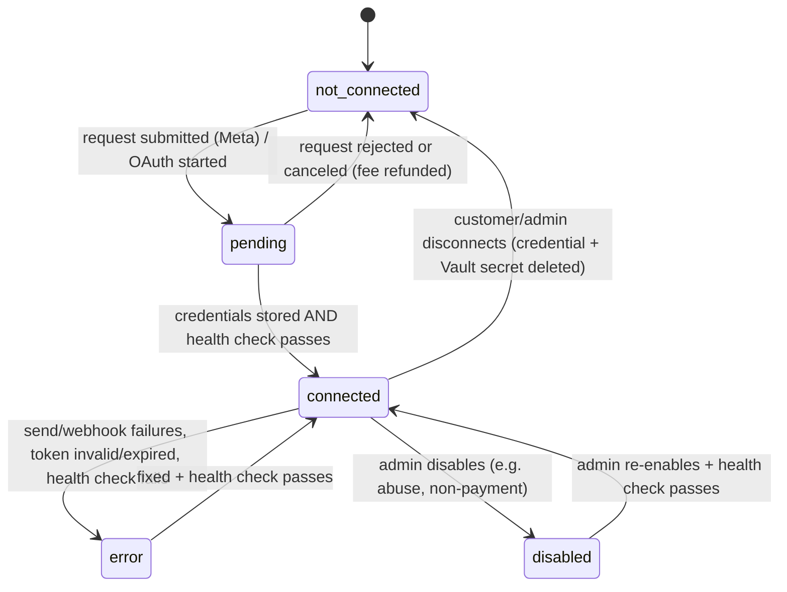
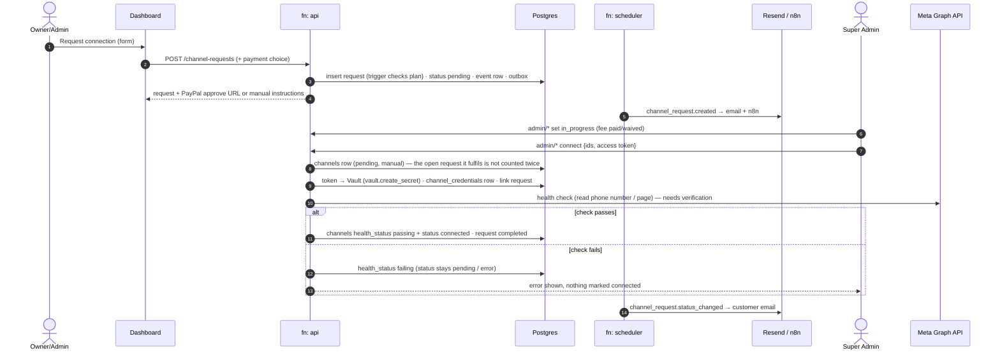

# Integrations: Channels & the Connect Section

Approved: A14, E2, E5, E13. Schema (migration `…000300`, applied to the dev project in P2):
`channels`, `channel_credentials` (service role only), `channel_connection_requests`,
`channel_connection_events`, `widget_settings`, `whatsapp_templates`. Plan gating:
`allowed_channel_types` + `max_meta_channels` (enforced by triggers). Flag:
`meta_embedded_signup` (OFF, E2).

**Rule: never fake a working integration.** Every status shown in the UI is the stored status of a
real row, set by the system or an admin after a verified check. The database refuses
`status = 'connected'` on a Meta channel unless `health_status = 'passing'` with a
`last_health_check_at` (constraint `channels_connected_requires_health`, tested in suite 08).

## 1. Connect section (UI spec — widget card P8, Meta cards P13)

Four cards, always in this order: **Website Widget · WhatsApp · Messenger · Instagram**.

| Card element   | Widget                                                                       | WhatsApp / Messenger / Instagram                                                                                                       |
| -------------- | ---------------------------------------------------------------------------- | -------------------------------------------------------------------------------------------------------------------------------------- |
| Header         | icon, name, one-line value prop (ar/en)                                      | same                                                                                                                                   |
| Status badge   | `Connected` / `Disabled` / `Not set up`                                      | channel: `Not connected` · `Pending` · `Connected` · `Error` · `Disabled`; request timeline shows `In progress` / `Rejected`           |
| Mode           | `Automatic`                                                                  | `Manual` (active path) · `OAuth` (only when `meta_embedded_signup` is on)                                                              |
| Plan gate      | always available                                                             | if not in plan → lock + "Available on Starter and above" / limit reached → "Upgrade to add more channels"                              |
| Primary action | _Customize & install_                                                        | `Not connected` → _Request connection_ (form + $49 fee) · `Pending` → _View request_ · `Connected` → _Manage_ · `Error` → _View issue_ |
| Details        | install snippet, allowed origins, appearance, preview, "Installed on X at Y" | connected account (phone/page/handle), last health check (time + result), last inbound/outbound, errors, request timeline, fee status  |

Status badge colors and copy are defined in the design system (`DESIGN_SYSTEM.md §8`).
"Installed on X at Y" comes from `widget_settings.installed_verified_at` / `installed_origin`,
written only by `widget-gateway` from a real load ping (P8).

## 2. Status machines

### Channel (`channels.status`, E5)

History of every change is kept in `channel_connection_events` (Phase 01's `disconnected` and
`rejected` channel statuses were folded into `not_connected` + history, E5).
`connection_mode`: `automatic` (widget), `manual` (admin enters credentials), `oauth` (Embedded
Signup v4 / Facebook Login for Business, P13, flagged). A check constraint ties `widget` ⇔
`automatic`. One external account (`external_account_id`) can be live in only one workspace
(unique index for every status except `not_connected`).

Widget channels are created `connected` automatically with the bot; customers can disable or
enable the widget (`widget_settings.is_enabled`).

### Request (`channel_connection_requests.status`)

`pending → in_progress → completed | rejected`, or `pending → canceled` by the customer.
`in_progress` and `rejected` exist only here (E5). Every transition appends a
`channel_connection_events` row (customer-visible unless `is_internal`). Open requests count
toward `max_meta_channels`.

## 3. Manual Meta flow (active path)

Form fields per channel (validated by zod in `api`, stored in `submitted_data`; never passwords):

| WhatsApp                                                                                                                                                          | Messenger                                                                  | Instagram                                                                  |
| ----------------------------------------------------------------------------------------------------------------------------------------------------------------- | -------------------------------------------------------------------------- | -------------------------------------------------------------------------- |
| Business name, display name, phone number to connect (E.164), does it already use WhatsApp Business App/API?, Meta Business Manager id (optional), contact person | Facebook Page URL, Meta Business Manager id (optional), page admin contact | Instagram handle (professional account), linked Facebook Page URL, contact |

The form explains, in both languages, what the customer will need to do (e.g. grant access to
their Meta Business account) — wording to be verified against Meta's current requirements.

## 4. Credentials (P5, §6/§7)

- The access token is stored in **Supabase Vault**; `channel_credentials.vault_secret_id` points
  at it. `channel_credentials` has RLS on, no policies and no client privileges: only the service
  role (Edge Functions) can read it (suites 03, 04, 06; verified on the dev project).
- The member-readable `channels` row has **no** credential columns.
- Replacing `vault_secret_id`, deleting the credential row, setting the channel to
  `not_connected`, deleting the channel or the workspace deletes the credential row and its Vault
  secret (triggers `channels_disconnect_cleanup` + `channel_credentials_vault_cleanup`, suite 06).
- `scopes` and `expires_at` record what Meta granted (names **needs verification**, P13); the
  scheduler warns before expiry.
- Credential changes are audit-logged (`audit_logs`).

## 5. Adapter contract

See [`ARCHITECTURE.md §8`](./ARCHITECTURE.md#8-channel-adapter-layer-a14). Each adapter
(`packages/channel-adapters`, contract in P7, Meta adapters in P13):

- `verifyWebhook()` — verify token (GET) / `X-Hub-Signature-256` (POST) before any parsing.
- `parseInbound()` — maps events to `NormalizedInboundEvent`; never throws on unknown event
  types (logs them as `unsupported`).
- `send()` — token from Vault (service role), sends text / media / interactive; returns the
  provider message id; maps provider errors to `retryable | permanent | auth_error`
  (`auth_error` moves the channel to `error`).
- `healthCheck()` — live read of the account; result stored on `channels.health_status`,
  `last_health_check_at`, `last_health_check_error`.

Messaging integrations contain no AI business logic (§11).

## 6. Platform specifics to verify before P13 (all **needs verification**)

| Topic                                              | WhatsApp Cloud API                              | Messenger                        | Instagram                  |
| -------------------------------------------------- | ----------------------------------------------- | -------------------------------- | -------------------------- |
| Account identifier stored as `external_account_id` | phone number id                                 | page id                          | IG professional account id |
| Other ids (`external_ids` jsonb)                   | WABA id, business id                            | business id                      | business id, page id       |
| Token type & expiry                                | system-user / business token                    | page access token                | page/IG token              |
| Webhook subscription                               | per app + WABA                                  | page subscription                | page/IG subscription       |
| Webhook event id for `webhook_events.event_id`     | no single id per delivery → hash of raw body?   | same                             | same                       |
| Messaging window                                   | 24 h customer-service window; templates outside | standard messaging window + tags | similar window rules       |
| Templates (`whatsapp_templates.category / status`) | provider values stored as returned              | —                                | —                          |
| Graph API version                                  | pinned via `META_GRAPH_API_VERSION`             | same                             | same                       |
| App review / permissions                           | required scopes for business messaging          | pages messaging                  | instagram messaging        |

## 7. Embedded Signup v4 / Facebook Login — P13, behind `meta_embedded_signup` (OFF)

What already exists for it (P2):

- `connection_mode = 'oauth'` enum value.
- `channel_credentials` + Vault (same as manual).
- `external_account_id` / `external_ids` / `config` hold what the signup returns (phone number
  id, WABA id, business id — **needs verification** of v4's exact outputs; v2 is deprecated).
- `feature_flags` row `meta_embedded_signup` (global, OFF) with per-workspace overrides,
  resolved by `private.feature_enabled()`.
- `ConnectionProvisioner` interface: manual provisioner (admin form) today; an OAuth provisioner
  in P13 exchanges the code from the Meta JS SDK popup for a token server-side and calls the
  same upsert.

What P13 adds: Meta JS SDK on the Connect page (only when the flag is on), an `api` route to
complete the exchange, webhook auto-subscription, mocked tests. The adapters, message pipeline,
schema and billing stay unchanged. The $49 fee may be dropped for self-serve connections — a data
change (`one_time_products.is_active`).

## 8. Website widget (automatic)

- Created with the first bot: `channels(widget, automatic, connected)` + `widget_settings`. The
  embeddable key is `bots.public_key` (`wk_…`, rotated via `api`).
- Install snippet (shown in dashboard):
  ``
- The widget refuses to load until at least one exact origin is in `allowed_origins` (E13);
  `widget-gateway` issues a short-lived signed session token (`WIDGET_SIGNING_SECRET`).
- Installation verification: the widget pings on load; `widget-gateway` records
  `installed_verified_at` + `installed_origin` (P8).
- Shadow DOM isolation, RTL/LTR from the bot/visitor language, logical position (`start`/`end`),
  keyboard and screen-reader accessible, ≤ 35 kB gzip target (P8).
